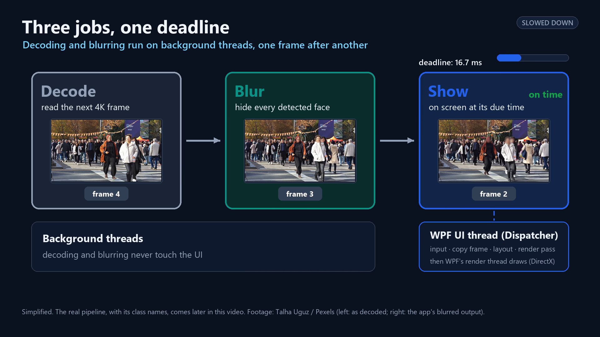
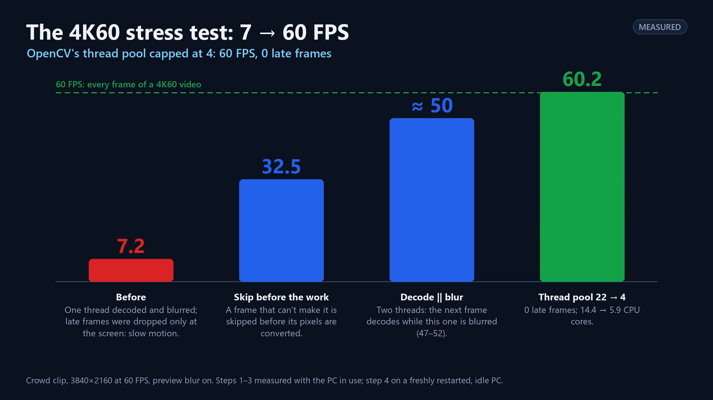
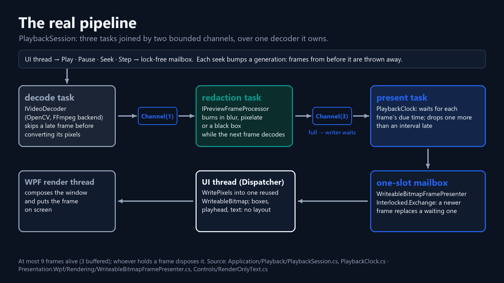

# Smooth 4K60 video in WPF

*From 7 FPS to 60, measured step by step.*

*VisionRedact Studio, episode 1. C# · .NET 10 · WPF · OpenCV (Emgu CV) · FFmpeg.*

With live face blur on, my app played a 4K60 clip at 7.2 FPS: 14.85 seconds of video took 26.72 seconds. The crowd moved in slow motion, a few jerky pictures a second. With every step they took, the video's clock
fell further behind real time.

VisionRedact Studio is my WPF app for blurring faces in video, and reviewing a video means playing it with the blur
on. I had added that clip to see whether dropping late frames kept playback smooth. It didn't. Four changes later, it
played at 60 FPS on the same laptop.

Redaction is the job of hiding people before a video is shared. Examples include evidence in a court case, police and
body-camera footage released to the public, CCTV footage someone asked for (with other people blurred where needed),
recordings from schools and hospitals, and news footage that shows bystanders. The AI finds the faces, and a person
checks them. Checking means watching the video with the blur on. That's why smooth playback matters here.

Why WPF? It's where I have the most experience: I've built many WPF applications. The same ideas (XAML, MVVM and data
binding) carry over to WinUI, UWP, Xamarin and .NET MAUI, so the patterns here transfer even where the controls
differ. In this app, only the Presentation project uses WPF, and a test checks that the core doesn't. So another front
end would replace that one layer, not the video pipeline.

> **How I measured**
>
> I measured on my development laptop: Intel Core Ultra 9 185H (22 logical processors, 64 GB of memory), RTX 3500 Ada
> laptop GPU, integrated Intel Arc, Release builds on .NET 10. Later episodes use the same laptop. FPS, late frames
> and layout passes come from the app's own Diagnostics counters. Wall time and frame intervals come from a harness
> that runs the real `PlaybackSession` with a timestamping sink and no UI thread. Paired numbers are from two runs.
> Stress-test steps 1 to 3 ran while the PC was in use. Step 4, the layout timing and the smaller-PC runs ran on a
> freshly restarted, idle PC. Nothing was measured on the display with an external tool.

## A frame every 16.7 ms

At 60 FPS, a frame is due every 16.7 ms, and three jobs must fit in that slot: decode the next frame, blur its faces,
and show it on WPF's UI thread.



| Clip | Frame interval | Decode per frame | What has to fit |
|---|---|---|---|
| 1080p30 | 33.3 ms | ~3.7 ms | easy |
| 1080p60 | 16.7 ms | ~3.7 ms | comfortable |
| 4K30 | 33.3 ms | ~13–16 ms | comfortable |
| 4K60 | 16.7 ms | ~15–16 ms | decode alone almost fills the slot |

Smooth doesn't mean fast. Smooth means on time. A fast average with late frames still stutters. At 4K60, decoding
alone almost fills the slot (a 3-frame buffer absorbs the spikes), so that clip became my stress test.

The AI runs before playback, as a face scan (YOLO11n on the GPU, 5 samples a second, 5.2–5.3 s for the 15-second
4K60 clip). During playback, the app blurs the boxes the scan found, live, on every frame.


In this crowd frame from the episode's cover, a few small, distant faces aren't blurred. The fast YOLO model, scanning
5 frames a second, misses some of them. That is what the larger model and the review step in episodes 3 and 4 are
for. I built the app so that a better model plugs in behind one interface, `IObjectDetector`, and I left model
evaluation out of the app's scope.

## First, the UI thread

On every frame, the UI thread (the Dispatcher's thread, which also handles input) runs my presenter. The presenter
copies the new frame into the bitmap with `WritePixels` and updates the boxes and the time. Then WPF's render tick runs
layout, if something asked for it, and the render pass. The render pass hands what changed to WPF's separate render
thread, which composes it on the GPU.

A layout pass is WPF measuring and arranging the elements on screen again. It runs on the UI thread, so if it
happens every frame, it takes time from every 16.7 ms slot. Anything that changes every frame can trigger one: a
property registered with `AffectsMeasure` or `AffectsArrange`, or a redraw through `InvalidateVisual`, which also
calls `InvalidateArrange`. A playhead moved by
Margin (measure + arrange) or Canvas.Left (arrange) would cost one layout pass per frame. My playhead has always used
a `TranslateTransform`.

I've built enough WPF apps to know that anything changing its text or size every frame can make WPF measure and
arrange the window again. So I counted the passes instead of guessing.

I added a "Layout passes / s" row to Diagnostics, based on the main window's `LayoutUpdated`. It showed one pass per
frame, caused by the time readout. Updating that text at most 10 times a second cut the layout passes to about 10 a
second. A fixed Width and Height on the readout did nothing: with the text updated every frame, it still showed
31.7 / 60.2 / 30.5 passes a second (1080p30 / 1080p60 / 4K30), because every change of `Text` schedules a measure. Once scanned clips put moving boxes on screen, the passes came
back.

| What changed every frame | Why it cost layout | Layout passes / s (1080p30 / 1080p60 / 4K30) |
|---|---|---|
| The time and frame readout, a `TextBlock` | `TextBlock.Text` is `AffectsMeasure \| AffectsRender` | 30.0 / 60.1 / 31.3 (no boxes on screen) |
| The face-box overlay, redrawn in `OnRender` | `InvalidateVisual` → `InvalidateArrange` | 31.9 / 60.1 / 31.6 (text already slowed to ≤ 10 / s) |

The fix for both was a retained drawing. A `DrawingGroup` is a list of drawing commands that WPF keeps in its render
tree. When the app re-records it, WPF only repaints that picture: no size changed, so no layout pass runs. The
timecode could also update on every frame again, so it is exact on every frame.

After that, 2.0 passes a second were left. A WPF ETW trace showed that they came from the Diagnostics panel's own
rows. Separately, sweeping the pointer across the timeline caused 35.7 passes a second, mostly from the hover card's
time label. I moved both to the same retained drawing (`RenderOnlyText`). Now playback runs at **0.0 / 0.0 / 0.0**
passes a second (1080p30 / 1080p60 / 4K30) with the boxes moving, and sweeping the timeline went from 35.7 to 0.0.

| Element | Technique |
|---|---|
| Video | `WritePixels` into one reused `WriteableBitmap`, so no binding changes |
| Face boxes | `BoxOverlay` re-records a retained `DrawingGroup` (`DrawingGroup.Open()`) |
| Timeline | ticks, ranges and markers drawn once in `OnRender`; playhead and hover card on a `TranslateTransform` |
| Time, frame number, Diagnostics values | `RenderOnlyText` re-records a retained `DrawingGroup` |
| Decode-ahead bar | a full-width rectangle on a `ScaleTransform` (a `ProgressBar` sets its indicator's `Width`) |

Everything that changes per frame now changes pixels, a transform or a retained drawing, never anything WPF has to
measure.

Later, on a freshly restarted idle PC, I timed the layout work. A Diagnostics row measures the time from the start of
WPF's render tick (a Render-priority Dispatcher operation: animation tick, layout, `CompositionTarget.Rendering`,
render pass) to `LayoutUpdated`. So the real layout time is slightly lower. I patched the row into the older build too.

| Build (crowd 1080p60, face boxes moving) | Layout passes / s | UI-thread time in layout | Presented FPS |
|---|---|---|---|
| Before (boxes redrawn with `InvalidateVisual`) | 60.2 | **62.1 ms per second** (≈ 1 ms per pass) | 60.2 |
| After | 0.0 | **0.0 ms per second** | 59.7 |

That is about 1 ms of every 16.7 ms frame, or 6 % of the UI thread. This laptop held 60 FPS either way, so the gain
is headroom. I'd expect a slower PC to feel it first. The zero-layout work was already in place when I measured the
7.2 FPS in the next section.

`WritePixels` costs about 0.6 ms per 1080p frame and 2.5–2.8 ms per 4K60 frame (p95 3.7–4.9 ms). `D3DImage` would
take that copy off the UI thread, but at the price of DirectX interop, and a copy this small doesn't justify that yet.
I'll revisit it for 8K or for several videos at once. [The UI thread, before and after](visuals/anim_2_ui_thread.mp4)
animates these parts in the real app.

## The 4K60 stress test

At 1080p and 4K30, the blurred preview showed 0 late frames, even when single frames went over budget. Then came the
4K60 crowd clip, the same scene as the 1080p60 one (1,217 detections, about 16 boxes per frame). I scanned it, turned
the blur on and played it from the start. FPS is measured in the app.

| Step | Presented FPS | Late frames (per 10–11 s) | PC |
|---|---|---|---|
| 1. One thread decodes and blurs; late frames dropped at the screen | **7.2** (14.85 s of video took 26.72 s) | 364 | in use |
| 2. Skip before the work | **32.5** (harness: 14.97 s for 14.85 s) | 264, 94 % skipped early | in use |
| 3. Decode and blur on two threads | **47.2 / 51.9** | 87 / 65 | in use |
| 3 again, the baseline for step 4 | **50.3–51.9** | 56–58 | freshly restarted, idle |
| 4. OpenCV thread pool capped at 4 | **60.2** | **0** | freshly restarted, idle |



[Dropping after the work vs skipping before it](visuals/anim_5_skip_before_the_work.mp4) animates both policies.

### Step 1: my drops came too late (7.2 FPS)

At that point, playback had two tasks. A decode task decoded and blurred each frame into a buffer of three. A present
task waited for each frame's due time and dropped any frame more than one interval late. My design note said dropped
frames would not be decoded for display. But my code decoded and blurred every frame and dropped the late ones
afterward, so a drop saved nothing.

Decode plus blur took about 29 ms per frame against a 16.7 ms slot, so about 34 frames a second came out. I had also capped
drops at 4 in a row: after every 4 drops, a late frame was forced onto the screen. The clock never restarted from that frame, so
lateness grew without bound. The harness showed 175 gaps of 5 (one frame shown, four dropped), 190 of 891 frames shown
and frames up to 11.9 s late. That is about 7 FPS, at 56 % speed. I had chosen dropping to avoid slow motion, and I
got slow motion anyway.

### Step 2: skip before the work (7.2 → 32.5)

Now the decode task predicts whether a frame would be more than one interval late. It bases the prediction on the
present task's published clock anchor (a reference frame number and its timestamp) and on smoothed costs. If the frame would be late, the decode task skips it
before its pixels are converted or blurred. The skipped frame still has to be decoded, because later frames need it,
but that costs 3.7–4.1 ms at 4K, against 10.4–10.6 ms for a full read with a reused buffer. Today's code already
takes step 3's second thread into account:

```csharp
// PlaybackSession.ShouldSkip: decoding overlaps with blurring the frames already handed over
var readyIn = TimeSpan.FromTicks((long)(Math.Max(_decodeCostTicks, queued * redact) + redact));
var ready = _timeProvider.GetElapsedTime(anchor.Timestamp) + readyIn;
var due = TimeSpan.FromSeconds((frameIndex - anchor.Frame) / Metadata.FramesPerSecond);
return ready - due > _clock.FrameDuration;
```

The cap of 4 now counts every frame left out since the one on screen. When the cap is reached, the next frame is
shown, and the clock restarts from that frame. Every other clip still showed every frame (one drop in 891 at 1080p60
with the blur on). 4K60 stayed uneven, with 45 gaps of 3–5 frames and a p99 lateness of 140 ms where the blur cost
peaks.

### Step 3: decode and blur on two threads (≈ 50)

Blurring moved to its own task behind a one-frame channel, so the next frame decodes while the current one is
blurred. No pixels are copied; the same frame object moves on. I ran it back to back with the step-2 build on the same
busy PC. FPS went from 26.9 / 31.2 to 47.2 / 51.9, and late frames from 264 / 252 to 87 / 65. The cost was more busy
cores (9.9 → 13.7–14.2) and two more frames in flight (+40–80 MB peak private).

For a fair comparison with step 4, I measured step 3 again on the idle PC: 50.3–51.9 FPS, so about 50 either way.

### Step 4: a smaller thread pool (≈ 50 → 60)

On their own, decode and blur each fit in 16.7 ms. With everything running, decode took 18.6–19.1 ms, playback showed
50–52 FPS with 56–58 late frames, and the app was using **14.4–14.6** of the CPU's 22 logical processors. I
attributed each thread's CPU time to the library that created the thread. Two thirds of the app's CPU time was
OpenCV's own thread pool: 22 worker threads, all busy, using 9.83 cores.

After the faster blur from episode 4 (each face is shrunk to about 48 pixels before blurring), blurring each face
takes a handful of tiny OpenCV calls on images about 48 pixels across, and
a frame has a dozen faces. OpenCV split every one of those calls across all 22 threads. For jobs that small, more
threads burn more CPU without finishing sooner. The busy pool also took cores from the decoder and the UI thread. A
whole-frame blur is the opposite case: it runs 6× faster with 22 threads than with one.

So I capped OpenCV's thread pool at 4 threads at startup. Playback reached **60.2 FPS with 0 late frames on 5.6–5.9
cores**, and the redacted output was identical. Export and analysis were as fast as before, or faster. The full
measurements are in `docs/Performance.md`.

## What the pipeline looks like now



`PlaybackSession`, in the Application layer, owns one decoder and runs three tasks joined by two bounded channels. The
UI thread sends Play, Pause, Seek and Step through a lock-free mailbox. The decode task is the decoder's only caller.
It feeds the redaction task through a one-frame channel, and the redaction task feeds the present task through
`Channel.CreateBounded(3)` with `FullMode = Wait`. A full buffer makes the writer wait, so memory can't grow with the
video. The present task paces frames with `PlaybackClock` and hands them to `IPreviewFrameSink`, the WPF presenter.
The presenter's one-slot mailbox lets a newer frame replace one that the UI thread hasn't drawn yet, so the UI thread
is never more than one frame behind.

```csharp
// WriteableBitmapFramePresenter.Present: called on the playback thread
var stale = Interlocked.Exchange(ref _pending, frame);   // put the new frame in, take the old one out
if (stale is not null)
{
    stale.Dispose();                                     // never shown, never will be: free it now
    Interlocked.Increment(ref _framesDropped);
}
if (Interlocked.CompareExchange(ref _renderQueued, 1, 0) == 0)
    _ui.Post(_renderCallback, DispatcherPriority.Render); // at most one callback queued on the Dispatcher
```

Every seek bumps a generation number, and frames from before the seek are disposed unseen, so a burst of seeks only
decodes the latest target. Whoever holds a frame owns it, and whoever drops it disposes it. Playback holds at most
`DecodeAheadFrames + 6` = **9** frames: up to 3 in the bounded buffer, plus the frame being decoded, the one in the
one-frame channel, the one being redacted, the one the present task holds, and the sink's pending frame and the one
it is rendering. The [due times and mailbox](visuals/anim_3_due_times.mp4) and
[backpressure](visuals/anim_4_backpressure.mp4) animations are labeled illustrations of these policies.

## On a smaller PC

I simulated smaller machines by restricting the app, and the ffmpeg.exe it starts, to some of this CPU's cores. Real
laptops of that class may be slower.

| Clip | 4 performance cores (4C/8T) | 4 efficiency cores |
|---|---|---|
| 1080p30 | 30.0 FPS, 0 late | 30.0 FPS, 0 late |
| 1080p60 | 59.9 FPS, 0 late | 18.4 FPS, 270 late (19 skipped early) |
| 4K30 | 30.0 FPS, 0 late | 8.2 FPS, 154 late (decode 59.5 ms > 33.4 ms budget) |
| 4K60 | 31.8 FPS, 157 late (94 skipped early) | 5.0 FPS, 174 late |

An overloaded machine shows fewer frames and keeps the video's speed (step 2). Here I measured frame rates and late
frames only.

## Costs and known limits

- The preview may skip a late frame. Export is a separate pipeline and never drops one.
- Two threads cost more CPU than one (step 3).
- Memory stays flat: however long the video, no measured run went above 10 live frames. 4K playback uses about 1 GB
  of private bytes. A 6-pass soak of a CPU-only test process stayed at 184–238 MB with no upward trend.
- A timer paces the frames. At 60 FPS, the time between presented frames has a standard deviation of 3.9–4.7 ms, and
  7–8 % of intervals exceed 1.5 frames without counting as drops. That fits Windows' ~15.6 ms timer granularity,
  though I haven't proven it. I timed the intervals in the harness and didn't measure the display with an external
  tool. (WPF composes at vsync, so a frame that misses a vsync is probably shown one vsync later, or replaced.)
- Variable frame rate files are paced as constant frame rate, so their playback timing can drift from the original.
  WPF's GPU upload of the bitmap after `WritePixels` is not measured.
- Decode stays on the CPU for now. Next I want hardware decode, measured first. After that, I want frames that stay
  on the GPU through decode, blur and display, with the CPU path as the fallback.

## Next

Episode 2 is YouTube-style timeline previews in WPF.

## Source

- `src/VisionRedact.Application/Playback/PlaybackSession.cs`, `PlaybackClock.cs`, `PlaybackOptions.cs`
- `src/VisionRedact.Presentation.Wpf/Rendering/WriteableBitmapFramePresenter.cs`
- `src/VisionRedact.Presentation.Wpf/Controls/RenderOnlyText.cs`, `BoxOverlay.cs`, `VideoTimelineControl.cs`
- `docs/Performance.md`, `docs/ThreadingModel.md`, `docs/adr/0009-preview-frame-dropping.md`,
  [measurements.md](../measurements/measurements.md)

Footage by Talha Uguz (crowd crossing) and Towfiqu barbhuiya (street scene), Pexels License.
