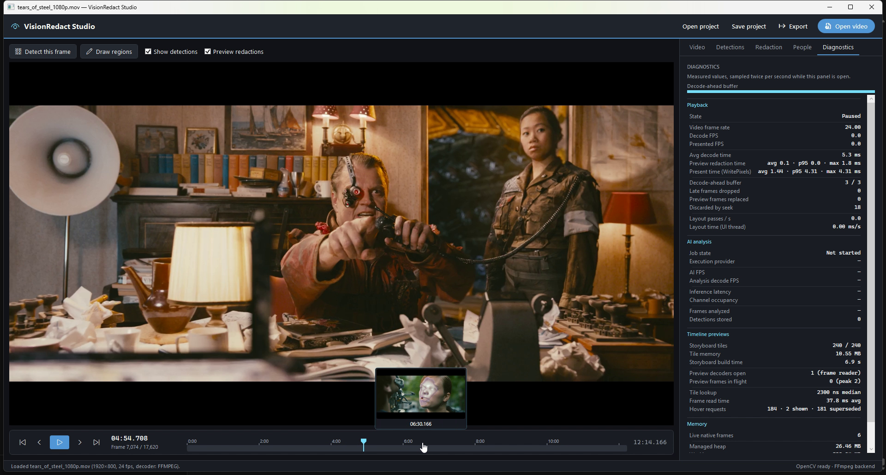
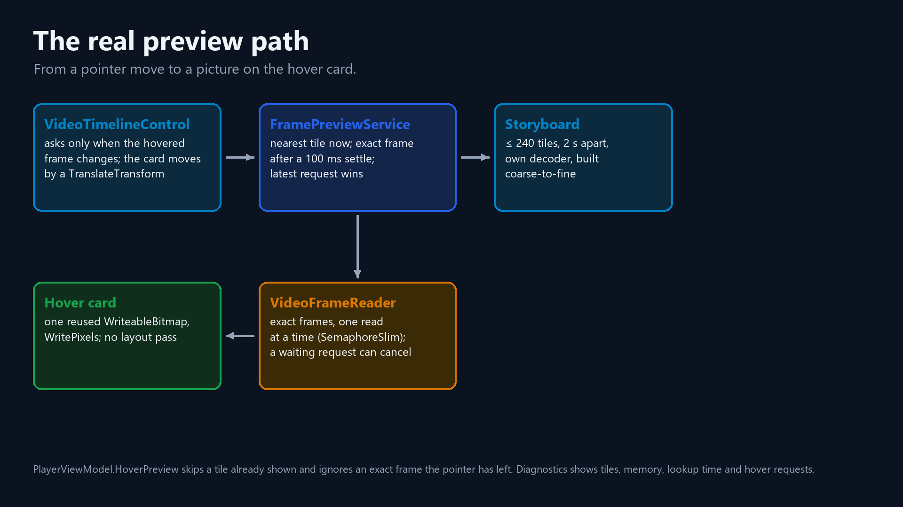
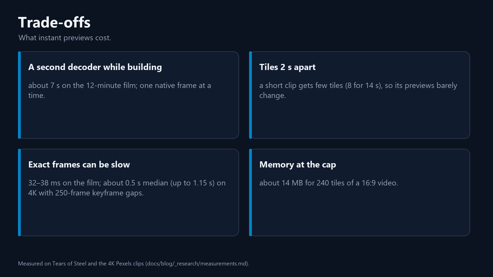

# YouTube-style timeline previews in WPF: half-second seeks, microsecond lookups

*VisionRedact Studio, episode 2 of the series. C# · .NET 10 · WPF · OpenCV (Emgu CV) · FFmpeg.*

My first hover preview, a small card that floats above the timeline, decoded the exact frame under the pointer. While
the mouse moved, the card kept its old picture. It changed only when the mouse stopped.

Reviewing a long video means finding the moments with faces quickly. Dragging blind and then waiting for each frame
to appear made that slow.

The preview waited for the mouse to stop because a seek is expensive. On my 4K test clips, which store a full picture
only every 250 frames, one seek and one read take about half a second (median 478–505 ms). Tears of Steel, the film I
test the app with, has a keyframe (a full picture) every 18 frames and seeks in about 25 ms. A pointer sweeping the
timeline asks for a new frame about 32 times a second.

YouTube shows storyboard thumbnails on hover. As far as is publicly documented, it doesn't decode the exact frame when
the pointer rests. Once the first storyboard tiles are built, my card shows a thumbnail at once, like YouTube. When the
pointer rests, the card then shows the exact frame. Finding the thumbnail takes a few microseconds. Here is how my app
does both, and what it costs.



A [12-second animation](visuals/anim_1_simple.mp4) shows the idea.

> **How I measured**
>
> Same laptop and Release builds as episode 1 (Core Ultra 9 185H, RTX 3500 Ada). App numbers are Diagnostics panel
> readings from logged sessions and this episode's recording, mostly with Tears of Steel open (1920×800, 24 fps,
> 12:14, 17,620 frames). Seek and storyboard costs come from my seek benchmark. It runs on four 14–15 s Pexels clips
> (1080p30 to 4K60) with a keyframe every 250 frames, with the PC in use. For each clip it makes 40 random seeks, each
> a `Seek` and one `ReadNext`, repeated over three passes, and I take the median across passes. Tears of Steel's 25 ms
> is from an earlier run. I count layout passes (WPF's measure and arrange, explained below) as `LayoutUpdated` events
> on the main window.

## Why I don't decode on every move

A video file stores a whole picture only at keyframes. The frames in between store changes. To show one frame, the
decoder seeks to the keyframe before it and decodes forward, frame by frame, up to the target.

When I first wrote the design down, I noted that a seek could take up to about 100 ms and that the mouse reports
every 10 ms or so. Then I measured the seek.

| Clip | Median | p90 | Max |
|---|---|---|---|
| 1080p30 | 152 ms | 276 ms | 365 ms |
| 1080p60 | 167 ms | 289 ms | 401 ms |
| 4K30 | 478 ms | 847 ms | 1,067 ms |
| 4K60 | 505 ms | 889 ms | 1,150 ms |

At 4K, the median alone is about five times my "up to" estimate. Seek cost follows the distance between keyframes as
much as it follows the resolution. That is why Tears of Steel seeks so much faster. I had no basis for the mouse
figure either, so I counted hover requests instead; one fires only when the frame under the pointer changes. A sweep
over a paused 1080p60 clip made 127 hover requests in 4 s, about 32 a second.

If I decoded every request in turn, that would ask for about 5 s of decoding per second of sweeping at 1080p, and
about 16 s at 4K. The queue would only grow, and the longer I swept, the older the card's pictures would get.
Playback's decoder can't help. It has one read position, and reading a preview through it would make the video jump.

Seeking only to the nearest keyframe would still decode on every move, and the picture would still be approximate. I
ruled it out.

An [animation](visuals/anim_2_seek_cost.mp4) shows why seeking is expensive.

## The first version decoded only the newest request

My first version had a single layer, which is still there in `FramePreviewService`. Each time the frame under the
pointer changes, `Request` is called:

```csharp
public void Request(long frameIndex)
{
    Interlocked.Increment(ref _exactRequests);
    var request = new CancellationTokenSource();
    Interlocked.Exchange(ref _current, request)?.Cancel();
    _ = RunAsync(frameIndex, request.Token);
}
```

Each request swaps itself in as the current one and cancels the one before. `RunAsync` then does four things.

1. It waits for `SettleDelay` (100 ms today, 80 ms then), using `Task.Delay` on the injected `TimeProvider`. A moving
   pointer cancels the request here, before anything is decoded.
2. It asks the shared `VideoFrameReader` for the frame, shrunk to fit 192×108. The reader opens its own decoder on the
   first read. It runs one read at a time (`SemaphoreSlim(1, 1)`) on a pool thread, because seeking and decoding are
   blocking native calls. A request canceled while it waits for the
   lock never decodes.
3. A started read cannot be stopped. If its request was canceled meanwhile, the picture is dropped and counted as
   superseded.
4. Otherwise, `RunAsync` raises `Ready` on the pool thread. The view model posts to the Dispatcher and shows the
   picture only if the pointer is still on that frame.

Tests drive a fake clock (`FakeTimeProvider`). When requests for frames 10, 20 and 30 arrive 30 ms apart, followed by
one settle delay of rest, exactly one frame is decoded: frame 30. A canceled hover never raises `Ready`.

This version worked as designed, and that was the problem. While the pointer moved, every request died in its wait,
so nothing reached the card until the pointer stopped. The moving pointer needed a layer of its own.

An [animation](visuals/anim_4_latest_wins.mp4) shows the latest request winning.

## A storyboard, built in advance



When a video opens, a background job now builds a *storyboard* of up to 240 small tiles. On every pointer move, the
card shows the nearest tile, and nothing is decoded. When the pointer rests for 100 ms, the exact frame from the first
version's layer replaces the tile.

The UI thread does little per pointer move. `VideoTimelineControl` turns the pointer's x into a frame and executes
`HoverFrameCommand` only when that frame changes. The control is lookless and never decodes, so the host supplies the
picture. `PlayerViewModel` sets the time label, writes the nearest tile into the card's bitmap unless that tile is
already shown, and calls `Request(frame)` for the exact frame. The control moves the card with a `TranslateTransform`.

`StoryboardJob` ("Build timeline previews") opens its own decoder and seeks to each planned frame. It shrinks each
frame to fit 192×108 with OpenCV's area interpolation (keeping the aspect ratio) and publishes the tile at once. The
job holds one native frame at a time and closes its decoder when it ends.

Tiles are at least 2 s apart, and there are never more than 240. Past 8 minutes, a video still gets 240 tiles, spread
more than 2 s apart. Tears of Steel has 17,620 frames, so its tiles sit about 73 frames (3 s) apart. They are built
coarse to fine: first, middle, quarters, eighths. A unit test pins the order down for a 16 s clip at 30 fps:

```csharp
Assert.Equal([0L, 240, 120, 360, 60, 180, 300, 420], plan);
```

A half-built storyboard already spans the whole timeline, just more coarsely.

`Storyboard` is immutable. Each new tile produces a copy with the tile inserted in frame order. The copy is published
with `Volatile.Write` under a lock, and the UI thread reads the current snapshot without a lock. A builder still
running for a previous video can no longer publish, because `Publish` checks that its job is still the current one.

The Diagnostics panel showed these values for Tears of Steel.

| Metric | Value |
|---|---|
| Storyboard tiles | 240 / 240, 192×80 each (46,080 bytes) |
| Tile memory | 10.55 MiB (the panel shows "10.55 MB" but counts in 1,024s), less than one decoded 4K frame (23.7 MiB) |
| Build time | 6.9–7.1 s (9.2 s in another session) |
| Preview decoders open | 2 while building, 1 after (the exact-frame reader) |

At the cap, a 16:9 video's tiles are 192×108 (62,208 bytes each), so 240 of them take 14.24 MiB.

Each tile costs a seek, so build time follows seek cost. On the 4K clips, each clip's 8 tiles took 4.8–5.5 s in my
seek benchmark, an average of 602–692 ms per tile.

An [animation](visuals/anim_3_storyboard.mp4) shows the storyboard filling in, coarse to fine.

## Finding the nearest tile

`Storyboard.Nearest` runs a binary search over the sorted tiles, then compares the neighbors on either side:

```csharp
var at = Array.BinarySearch(_tiles, new StoryboardTile(frameIndex, null!), ByFrame.Instance);
if (at >= 0)
{
    return _tiles[at];
}

// ~at = index of the first tile after the frame: compare it with the one before.
var after = ~at;
```

For 240 tiles, that is about 8 comparisons, on the UI thread, every time the hovered frame changes.
`FramePreviewService.NearestTile` times each lookup and keeps the last 64, and the Diagnostics panel shows their
median: **2–5 µs** in the app, a tiny fraction of a 16.7 ms frame.

The panel did not always show a median.

## The measurement that lied, and the mistake was mine

A binary search over 240 tiles should be fast, and a quick benchmark agreed: about 71 ns a lookup. The first version
of the Diagnostics row showed 7,573–11,818 ns, more than a hundred times slower.

That row showed a mean of only a few lookups, and one of them was the very first call, when .NET compiles the method
(JIT). That one call took about 100 µs and pulled the average up. The benchmark was also a best case: a million
lookups in a row, with everything in the CPU's cache, which a lookup on a mouse move never gets.

So the row now shows the median of the last 64 lookups, and nothing until it has 8, and I moved on. The lesson I
kept: write the conditions next to a benchmark number, and use a median when one slow call can skew the average. The
full numbers are in [measurements.md](../measurements/measurements.md), and an [animation](visuals/anim_5_mean_lied.mp4) replays
the mean that lied.

## 405 requests, 5 pictures


By the end of this episode's recording, the Hover requests row read **405 requests · 5 shown · 400 superseded**. The
counter keeps adding up, so that total covers the whole recording: a slow sweep, a rest and a fast sweep back. A
session I logged earlier read 22 · 1 · 21, and later 77 · 2 · 75. Another session read 57 · 2 · 55.

"Superseded" counts both ways a request can lose: canceled before decoding (usually during the 100 ms wait), or
decoded after the pointer had moved on. The counter does not tell them apart.

An exact read on the film (seek, decode and resize, without the 100 ms wait) took 32.0–37.8 ms on average in the
recording, and 37.2 ms in the logged session.

## A hover card that never asks for layout

WPF's UI thread (the Dispatcher's thread) handles input, the copy into the bitmap (`WritePixels`), layout (measure and
arrange) and the render pass. WPF's separate render thread then composes the result on the GPU. Episode 1 set one rule
for playback, and it holds for the card too: whatever changes on every move may touch pixels, a transform or a
retained drawing, but nothing that needs a layout pass.

| What changes per move | Technique |
|---|---|
| Card position | `TranslateTransform.X`, clamped to the track |
| Picture | `WritePixels` into one reused `WriteableBitmap` (Bgr24), with a new bitmap only when the picture size changes (a new video) |
| Time label | `RenderOnlyText`, the app's own label: its text is drawn into a retained `DrawingGroup` that each new value re-records (`DrawingGroup.Open()`), and its width comes from its parent, never from the text |
| Show / hide | `Visibility.Hidden`, so the card keeps its layout slot |

```csharp
var trackWidth = _track?.ActualWidth ?? ActualWidth;
var width = _hoverPreview.ActualWidth;
_hoverTransform.X = Math.Clamp(x - (width / 2), 0, Math.Max(0, trackWidth - width));
```

The card is not hit-testable, so it never steals the mouse from the timeline.

I got there in two steps. At first, the card hid with `Collapsed`. I switched it to `Hidden` so that showing and
hiding the card stopped costing a layout pass. The time label took longer to find. Playback still caused 2.0 layout
passes a second, all from the Diagnostics panel refreshing its own rows twice a second. I was using a WPF ETW trace to
find what those passes measured. The trace showed that the card's time label, which was then a `TextBlock`, was
measured 43 times while I hovered (the thumbnail: 3 times). I moved the label to `RenderOnlyText`, along with the
Diagnostics rows that refresh twice a second.

With a 1080p60 clip paused and the pointer sweeping (127 hover requests in 4 s), the main window ran 35.7 layout passes
per second before the move to `RenderOnlyText` and 0.0 after. The recording shows 0.0 while the pointer sweeps.

A WPF `Popup` could draw the card outside the window. But a `Popup` is a separate window, and moving a window should
cost more than changing a transform, so the card stays inside the timeline.

## What it costs, and known limits



- A second decoder while the storyboard builds, which takes about 7 s on the film. After that, previews keep one
  decoder.
- 10.55 MiB of tiles for the film, and at most 14.24 MiB for a video of any length.
- While the pointer moves, the picture is the nearest tile. Tiles are 2 s or more apart (about 3 s on the film), so
  the picture is only near the pointer's frame, not at it. Only a rest brings the exact one. A 14 s clip gets only 8
  tiles, so its previews barely change while sweeping.
- An exact frame needs 100 ms of rest plus one read, which takes 32–38 ms on the film. On 4K files with keyframes 250
  frames apart, that read is slow. A started read cannot be canceled, and reads run one at a time. So after a fast
  move, the next exact frame can wait behind a read of about 0.5 s median (p90 847–889 ms, max 1.15 s).
- A storyboard for a long 4K video would take about 2.5 minutes to build: 240 tiles at 0.6–0.7 s each. That is an
  estimate I haven't checked on a long file. Meanwhile, the coarse-to-fine order keeps a partial storyboard useful.
- I never measured the mouse's own event rate (the 32 requests a second count changes of the frame under the
  pointer). I also never measured the latency from a pointer move to the tile on screen.
- I ruled out two alternatives without measuring them: seeking only to the nearest keyframe, and a `Popup` for the
  card.
- The 100 ms wait is a setting (`SettleDelay`). I raised it from 80 ms when I added the storyboard, but never measured
  an optimum. A shorter wait starts more reads that a moving pointer wastes, and a wasted read delays the next one. A
  longer wait delays the exact frame.
- The Frame read time row is still a mean (labeled "avg"). It also counts the People tab's face-thumbnail reads,
  which share the reader. Given the story above, it should be a median.
- Replaced `CancellationTokenSource` objects are canceled and never disposed, on purpose. Disposing one could race
  with the delay or the read registering a callback, and a source without timers holds nothing to free.
- Copying the storyboard for every tile is quadratic: at most 240 references per copy, next to a seek and a decode per
  tile. In exchange, the UI thread reads without a lock.

## Next

Episode 3: a YOLO face model from Hugging Face, running locally in C#, on the GPU.

## Source

- `src/VisionRedact.Application/Preview/FramePreviewService.cs`, `Storyboard.cs`
- `src/VisionRedact.Application/Media/VideoFrameReader.cs`
- `src/VisionRedact.Infrastructure.Video/EmguFrameImaging.cs`
- `src/VisionRedact.Presentation.Wpf/Controls/VideoTimelineControl.cs`, `Themes/Generic.xaml` (`PART_HoverPreview`)
- `src/VisionRedact.Presentation.Wpf/Features/Player/PlayerViewModel.HoverPreview.cs`
- `src/VisionRedact.Presentation.Wpf/Features/Diagnostics/PreviewDiagnosticsSource.cs`
- `tests/VisionRedact.Application.Tests/Preview/FramePreviewServiceTests.cs`, `StoryboardTests.cs`
- `docs/adr/0023-timeline-hover-preview.md`, [measurements.md](../measurements/measurements.md), [b10-output.txt](../measurements/b10-output.txt)

Footage: Tears of Steel (CC) Blender Foundation | mango.blender.org, CC BY 3.0 creativecommons.org/licenses/by/3.0, shown in the app (faces blurred where redaction is on)
