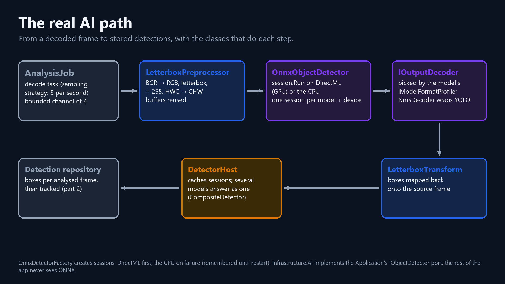
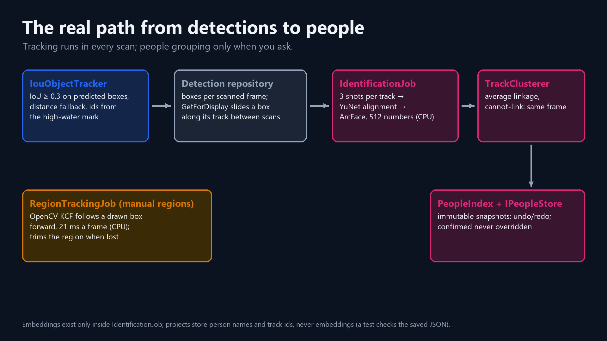
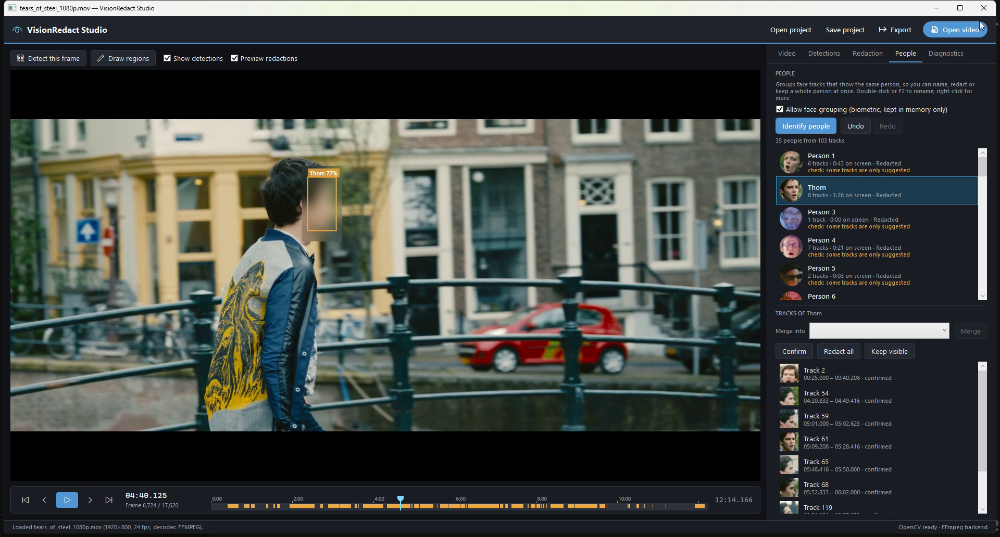
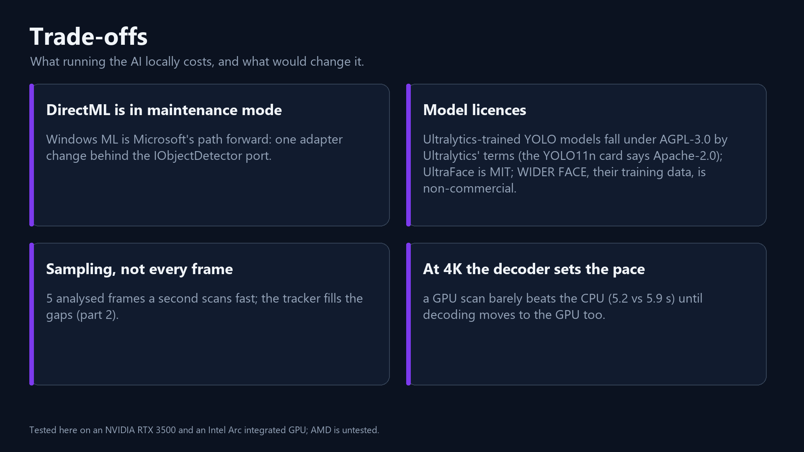
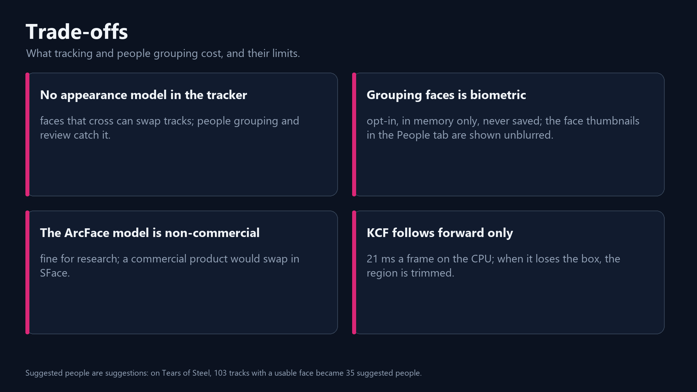

# Local AI on the GPU in C#: Hugging Face YOLO with ONNX Runtime and DirectML, from faces to people

*Episode 3 of my VisionRedact Studio series. C# · .NET 10 · ONNX Runtime · DirectML · OpenCV (Emgu CV).*

On the CPU, YOLO11n needed 23.4 ms to find the faces in one 1080p frame. My scan analyzed every frame at 39 frames a
second, and the four-frame queue between the video decoder and the detector sat at 4/4. The decoder was always waiting
for the model while the laptop's RTX GPU sat idle.

Today the app scans every frame of a 4K street clip at 10 ms a frame on that GPU, and the queue is empty. It runs
community YOLO face models hosted on Hugging Face through ONNX Runtime and DirectML inside a C# app, with no Python at
runtime and no server. The video never leaves the PC. Part 2 turns boxes into tracks, so a box can follow a face across
the frames the scan skips. If you allow it, those tracks then become people you can name and redact as a whole.
There are short animated versions of [local AI in three steps](visuals/detect_anim_1_simple.mp4) and
[from boxes to people](visuals/people_anim_1_simple.mp4).

Why AI at all? Redaction hides the people in a video before it's shared. It is used for court evidence, police and
CCTV footage, schools, hospitals and the news. By hand, that means drawing over every face in every frame. My 23-minute
test recording, at 59.94 fps, has 82,373 frames. A face detector finds the faces across the whole video, and a person
reviews what it found (episode 4). Running the detector locally matters as much as running it fast. Footage that needs
redacting is exactly the footage that shouldn't be uploaded to someone else's server.

> **How I measured.** I used the same laptop and Release builds as episode 1 (Core Ultra 9 185H, RTX 3500 Ada). Times
> come from my benchmark harness (which uses the app's own classes) or are read from the app. Single-frame `Detect()`
> times are p50s of 200 runs after 10 warm-ups. I didn't record the PC's state for those. The three-model comparison
> analyzes every frame of each clip in three passes (YOLO26l ran in only one of them), with the PC in use. Each figure
> is the median across passes, and the `Detect()` row is each pass's mean. The 4K scans, the simulated smaller machines
> and the grouping time were measured on a freshly restarted, idle PC. My first harness run of those put inference on
> the CPU, because that was the harness's default. I discarded it and made the harness pick the GPU, as the app does.
> Face counts are what each model reports, not checked against ground truth.

## Part 1: Local inference

### Three models, one street

The scan (`AnalysisJob`) runs a face detector on chosen frames and stores the boxes. Playback and export only read
those boxes (episodes 1 and 4). `scripts/download-model.ps1` fetches the three built-in pretrained detectors and checks
them against pinned hashes. I picked three that span the trade-off: the fastest, a balanced one and the most accurate.
They also don't share an output format, so the code that turns a model's output into boxes (its output decoder, step 4
below) couldn't quietly assume one.

| Model | Where it comes from | Input | Default confidence |
|---|---|---|---|
| UltraFace RFB-320 | ONNX Model Zoo, via its Hugging Face mirror | 320×240 | 0.7 |
| YOLO11n face | Hugging Face `AdamCodd/YOLOv11n-face-detection`, trained on WIDER FACE, ~10.6 MB | 640×640 | 0.35 |
| YOLO26l face | Hugging Face `uralman/yolo26l-widerface`, 99.6 MB, exported NMS-free | 1280×1280 | 0.3 |

On frame 211 of the 4K street clip (in the episode's video), UltraFace reports 2 faces, YOLO11n 6 and YOLO26l 22.
Over all 420 frames of the same street at 1080p30, on the RTX 3500 at default thresholds:

| Per frame, street clip | UltraFace | YOLO11n | YOLO26l |
|---|---|---|---|
| Faces reported (1080p / 4K) | 4.2 / 4.2 | 9.1 / 9.1 | 25.0 / 26.0 |
| `Detect()` mean (1080p) | 3.1 ms | 5.4 ms | 74.0 ms |

More boxes can mean more real faces or more false ones. I only measured agreement. On every 6th frame of Tears of
Steel (an open short film by the Blender Foundation), 1,717 faces were found by both YOLO11n and UltraFace, 457 by
YOLO11n alone and 161 by UltraFace alone.

UltraFace is fast but weak on small faces. On one private 1080p clip with ~30 px faces, it found none. YOLO26l is meant
for small or crowded faces, and it is slow. It takes 756 ms for one Tears of Steel frame on the CPU and 78 ms on the
RTX 3500 (mean of 30). On the street clip it scans about 13 frames a second, and video memory peaks at 1,075 MiB.

I'm not evaluating model performance. I'm building an app that lets a better model plug in later, through one
interface (`IObjectDetector`) and a format profile per model family. That's what the clean architecture is for. The
fast default, YOLO11n, misses some small, distant faces (Part 2 measures how many on one file). So the app also offers
the larger YOLO26l, plus a review step where a person boxes what the model missed (episode 4).

### One frame through the model



1. **Letterbox.** For YOLO11n, the frame is scaled to fit into 640×640 while keeping its shape, so 3840×2160 becomes
   640×360. Gray 114 fills the rest, as in training (UltraFace pads with 127). OpenCV shrinks the frame straight from
   its native memory with `INTER_AREA`.
2. **Tensor.** The pixels become three RGB planes, reordered from HWC to CHW, with each value divided by 255
   (UltraFace uses (x − 127) / 128). That's 1 × 3 × 640 × 640 floats, 4.9 MB (4,800 KiB), in a buffer allocated once
   per detector.
3. **Run.** `InferenceSession.Run`. The cancellation token sets `RunOptions.Terminate`, which stops a run between
   graph nodes.
4. **Decode.** YOLO11n answers with 1 × 5 × 8,400 values: 8,400 candidate rows of 5 values each (center x, center y,
   width, height and score). It predicts on three grids whose cells are 8, 16 and 32 px wide (its strides), so at
   640×640 there are 80² + 40² + 20² = 8,400 grid positions. YOLO11 is anchor-free: it predicts one box per grid
   position, with no preset box shapes ("anchors"). The 168 KB output is read through spans and never copied. Rows
   scoring 0.35 or more are kept.
5. **Map back, then NMS.** `LetterboxTransform` maps each box onto the source frame (normalized and clamped, with tiny
   boxes dropped). Non-maximum suppression (NMS) keeps the best of overlapping boxes. It drops a box whose IoU
   (intersection over union: shared area ÷ combined area, 0 to 1) with a higher-scoring box of the same class is above
   0.4, and keeps at most 300.

```csharp
// OnnxObjectDetector.Detect, under a lock (the buffers are reused)
var transform = _preprocessor.Prepare(frame);
using var input = OrtValue.CreateTensorValueFromMemory(_preprocessor.Tensor, _preprocessor.Shape);
// …
outputs = _session.Run(runOptions, _inputNames, [input], _outputNames);
// …
return _decoder.Decode(outputs, transform, _confidenceThreshold, _options.MinimumBoxSize);
```

[One frame's journey, animated](visuals/detect_anim_2_letterbox.mp4).

### Doing less work per frame

Most frames never reach the model. By default, the scan analyzes 5 frames per second of video. `TargetRateSampling`
decides each frame by applying a `double` step to the absolute frame index. There is no running counter, so rounding
errors never accumulate. At 59.94 fps it analyzes every ~12th frame (75 of 892 on the 60 fps crowd clip), and at
30 fps every 6th (70 of 420). I chose a fixed rate over dropping frames under load, because dropping frames would make
coverage depend on CPU speed. A face seen only between samples is missed.

My first version still read every skipped frame in full and then threw it away. Of all native frame allocations, 92 %
were for frames that were discarded immediately. A skipped frame must still be decoded, because later frames depend
on it, but it never needs converting to pixels:

```csharp
// AnalysisJob.ProduceAsync
if (!_sampling.ShouldAnalyze(index))
{
    // Grab without retrieving pixels: no colour conversion, no 6 MB allocation for skipped frames.
    if (!decoder.Skip())
    {
        break;
    }
    // …
}
```

`Skip()` is OpenCV's `VideoCapture.Grab()`. In a benchmark on the first 1,800 frames of my real 23-minute file,
throughput went from 272 to 615 frames/s (2.3×), and native frame allocations fell from 1,800 to 150. At 4K, a grab
costs 3.7 ms and a full read costs 13.0–13.3 ms.

The second waste was in preprocessing. The resize target, the padded canvas and the tensor were allocated for every
frame, so every tensor landed on the Large Object Heap. That meant 4,800 KiB per frame, 99 Gen0, 99 Gen1 and 99 Gen2
collections per 300 frames, and 2.95 ms a frame. Every collection stops all managed threads at least briefly,
including the UI thread, and Gen0 and Gen1 collections stop them for their whole duration. Now `LetterboxPreprocessor`
allocates once per detector, `OrtValue.CreateTensorValueFromMemory` wraps (pins) the reused array, and the decoders
read spans. That gave **0.3 KB per frame, no collections, 2.09 ms (29 % faster)**, and a whole `Detect()` call
allocates 1.0–1.4 KB. The change cost me re-entrancy. A lock serializes calls, and the parallelism comes from ONNX
Runtime's threads inside one run.

[Doing less work per frame, animated](visuals/detect_anim_6_sampling.mp4).

### Moving inference to the GPU

That left the model. On the CPU, `InferenceSession.Run` took about 80 % of a `Detect()` call (preprocessing took
2.1 ms of 23).

`Microsoft.ML.OnnxRuntime.DirectML` 1.24.4 holds both the CPU and the DirectML execution providers. CUDA would tie
the app to NVIDIA and to a multi-gigabyte CUDA + cuDNN install. DirectML runs on any DirectX 12 GPU, including both of
this laptop's GPUs, from one NuGet package. Adding CUDA later should be a change to one class,
`OnnxDetectorFactory`.

`DxgiAdapterCatalog` lists GPUs with DXGI's `EnumAdapters1`. The `EnumAdapters1` index is DirectML's device id (WMI
may order the GPUs differently). The catalog defaults to the GPU with the most dedicated memory, here the RTX 3500.
`OnnxDetectorFactory` adds DirectML (memory pattern off, sequential execution) and falls back to the CPU if the GPU
fails:

```csharp
catch (OnnxRuntimeException ex) when (target.Device == InferenceDevice.DirectML)
{
    // …
    (session, provider) = CreateSession(model.FilePath, InferenceTarget.Cpu);
    provider = $"CPU (GPU failed: {target.Name})";
}
```

Diagnostics shows the provider string. `DetectorHost` caches one session per (model, device), so a fallback lasts
until the app restarts.

| `Detect()` p50, one 1080p frame | CPU | Intel Arc (integrated GPU) | RTX 3500 Ada laptop GPU |
|---|---|---|---|
| YOLO11n | 23.4 ms | 14.2 ms | **4.7 ms** |
| UltraFace | 5.5 ms | 3.7 ms | **2.4 ms** |

YOLO11n is 5× faster on the RTX 3500 than on the CPU, and 1.65× faster on the Arc. A later run of the same benchmark
gave 24.9 ms (CPU), 13.4 ms (Arc) and 5.3 ms (RTX 3500). Warm-up (shader compilation) is excluded. On every frame of a
synthetic 1080p clip, the whole pipeline went from 39 frames/s on the CPU to 152 on the RTX 3500, so that scan finished
in about a quarter of the time, and Diagnostics named the RTX as the device running the model. An integration test runs
UltraFace on every GPU it finds and checks the results against the ONNX Model Zoo reference outputs, within 2×10⁻² to
allow for fused GPU arithmetic.

[CPU against GPU, animated](visuals/detect_anim_3_speed.mp4).

### At 4K the decoder sets the pace

During a scan, a decode task feeds a bounded channel of 4 (`FullMode = Wait`), and a consumer runs `Detect()`, the
tracker and the repository. The Detections tab shows `inference N ms/frame · queue a/b`. The inference figure is the
average of a whole `Detect()` call. At 4K that includes shrinking a 3840×2160 frame, which is why the tagline's 10 ms
is higher than the 4.7 ms above. The episode's video scans every frame of the 4K30 street clip with YOLO11n:

| Device | Inference | Queue | Who is waiting |
|---|---|---|---|
| RTX 3500 (DirectML) | 10 ms a frame | empty | the detector waits for the decoder |
| CPU | 28 ms a frame | full | the decoder waits for the detector (backpressure) |

Decoding a 4K frame takes about 13–16 ms here. That is longer than the RTX 3500's 10 ms, so on the GPU the decoder
sets the pace. In the harness, scanning every frame of a 4K30 clip ran at 64–67 frames/s with GPU inference and 31–32
on the CPU. The 15 s 4K60 crowd clip, at the default 5 frames a second, took 5.2–5.3 s on the GPU against 5.9 s on the
CPU. In the app, a 23-minute 1080p59.94 file at 5 frames a second ran at 29.9 analyzed frames/s on the CPU
(queue 4/4) and 58.5 on the RTX 3500 (queue 0/4, decoder at 726 frames/s).

The GPU matters most on a weaker CPU. I simulated smaller machines by restricting the process to some of this CPU's
logical processors, with the same RTX 3500. These cores are fast, so a real laptop of that class may be slower. With
4 performance cores (8 threads), a 14.9 s 1080p60 clip at 5 frames a second took 2.9 s with GPU inference and 15.2 s
on the CPU. With 4 efficiency cores it took 5.2 s and 64.3 s.

### A model family that would have decoded into garbage

Adding YOLO26 exposed a bug that never shipped. Ultralytics' default export for YOLO26 has changed between versions.
The version this model came from, 8.4.x, exported NMS-free by default, while the export in the current docs produces
raw predictions. This model was exported NMS-free (its metadata says `end2end: True`), so its output is already the
final boxes: `[1, 300, 6]`, with each row holding x1, y1, x2, y2, score and class. My factory accepted any `[1, a, b]`
output as YOLO. It would have read 300 candidate rows with 2 classes and taken the corners for centers and sizes. The
result would have been wrong boxes and no error. NMS was also hard-wired in the detector, and an NMS-free head keeps
overlapping faces on purpose (people hugging). A second NMS would drop one of those faces.

Now each model family has a profile. `IModelFormatProfile.Bind` checks the outputs when the model loads and returns a
`DecoderBinding(PreprocessSpec, IOutputDecoder)`. `YoloProfile` requires the row count of the stride grid: 8,400 at
640×640, or 8,500 with an extra stride-64 output. The code still calls the rows anchors (message shortened):

```csharp
var expected = YoloGrid.AnchorCounts(inputWidth, inputHeight);
var anchorsLast = expected.Contains(dims[2]);
if (!anchorsLast && !expected.Contains(dims[1]))
{
    throw ModelContract.Violation(model, $"output [{string.Join(", ", dims)}] has no anchor dimension of …");
}
```

The message names the shape and the expected counts, then asks whether the model is an NMS-free export
(YoloEndToEnd). `YoloEndToEndProfile` binds a decoder that filters, maps and caps the boxes, with no NMS. In the
metadata of custom Ultralytics models, `end2end` (an NMS-free head) or `nms` (NMS built into the graph) means the
output is already final boxes. `imgsz` gives the export input size (1280 here). 22 decoder tests run on hand-made
tensors, with no model file.

[A model family that speaks a different format, animated](visuals/detect_anim_4_profiles.mp4). The wrong boxes in that
animation are drawn to show what the old code would have done.

### The patterns doing the work

- **Ports and adapters.** The Application layer owns `IObjectDetector`, `IObjectDetectorFactory`,
  `IDetectionModelCatalog` and `IInferenceDeviceCatalog`. `Infrastructure.AI` implements them, and nothing else
  references ONNX Runtime.
- **Strategy.** `IModelFormatProfile` (UltraFace, Yolo, YoloEndToEnd), an `IOutputDecoder` per family, and
  `IFrameSamplingStrategy` (every frame, every Nth, target rate).
- **Decorator.** `NmsDecoder(inner, IoU 0.4, max 300)` wraps the UltraFace and YOLO decoders. YOLO26's decoder goes
  without it.
- **Composite.** `DetectorHost` lets several models answer as one detector. Their boxes are concatenated, with no NMS
  across models.
- **Factory with fallback.** `OnnxDetectorFactory` tries DirectML, then the CPU.

[The patterns, animated](visuals/detect_anim_5_patterns.mp4).

## Part 2: From detections to people



A detector reports boxes with no identity. But review, the box shown on the frames the scan skips, and grouping people
all need to know which boxes belong to the same face.

### A tracker, and a box that fell behind the face

`IouObjectTracker` gives each detection a `TrackId` on every analyzed frame. The tracker may set `TrackId`, but it
never changes a box or a confidence. A detection is a fact and a track is an interpretation, so tracking can be re-run.
My first version matched by overlap alone and broke small, fast faces into pieces. It made 271 tracks for 1,262
detections on cricket footage at 5 frames a second (an early number without a raw log).

Then I saw the boxes lag in the preview. At 5 analyzed frames a second of 59.94 fps footage, about 1 frame in 12 is
scanned, and the repository held each scanned frame's boxes for the next 11 frames (`HoldFrames` = 11). A box stood
still, then jumped, and a moving face could slide partly out of its blur, in export as well as in the preview.

I had two suspects. The first was frame numbering after seeks, and I ruled it out: 5 of 5 seeks on the real file
delivered exactly the frame that a sequential decode produces (pixel difference 0.00). A benchmark confirmed the
second suspect, the hold. Now `GetForDisplay` slides each box toward the same track's box on the next scanned frame
(`NormalizedRect.Lerp`). A box with no match there is held, so redaction never shrinks.

Sliding alone helped little. Faces about 30 px tall move half their width or more between scanned frames. Their
overlap falls under 0.3, and a new track starts. Even with motion prediction, the tracker made 262 tracks in one
minute of footage, so a box often had nothing to slide toward. A distance fallback brought that down to 80 tracks. The
tracker is now a SORT-style baseline, with its Kalman filter reduced to a smoothed velocity:

- Each live track predicts its box (constant velocity, smoothing 0.6).
- A detection joins the track whose predicted box it overlaps most, at IoU ≥ 0.3 and only within the same class.
- Failing that, a distance fallback accepts a center within 1.5 box sizes and an area ratio of 0.4–2.5.
- IoU matches always outrank distance matches. Matching is greedy, best first, one detection per track.
- A track closes after more than 3 analyzed frames without a match.

```csharp
if (iou >= IouThreshold)
{
    pairs.Add((1 + iou, t, d));
}
else if (MaxCentreDistance > 0 && SimilarSize(predicted, box))
{
    // …
    if (distance <= MaxCentreDistance)
    {
        pairs.Add((1 - (distance / MaxCentreDistance), t, d));
    }
}
```

My tracking benchmark replays the app's 1-in-12 sampling over the first 3,600 frames (about a minute) of a private
1080p59.94 file on the RTX 3500. It compares the result against YOLO11n run on every frame (9,963 faces, 9,135 of them
between scanned frames). A box counts as off the face when its center is more than 8 px away.

| Between scanned frames | Tracks | Faces covered (box + 20 % padding) | Center error p50 | Boxes off the face |
|---|---|---|---|---|
| Hold the last box | – | 78.8 % | 2.5 px | 17.9 % |
| Slide, IoU + prediction | 262 | 78.9 % | 1.1 px | 13.8 % |
| Slide, + distance fallback | **80** | **83.0 %** | **1.0 px** | **4.3 %** |

The other ~17 % of faces, the ones no box covered, were detector misses on the scanned frame, which sliding cannot fix.

I considered ByteTrack and DeepSORT. I didn't use them, because DeepSORT needs an appearance model and pixels.
ByteTrack doesn't, but it matches by IoU (with a Kalman filter), and IoU matching is what broke small, fast faces
here. The benchmark shows that this tracker is enough for the box between scanned frames. Its weakness is identity
swaps in crowds, and a stronger tracker can go behind `IObjectTracker`.

[Hold against slide](visuals/people_anim_2_hold_slide.mp4) and
[linking boxes into tracks](visuals/people_anim_3_tracks.mp4), animated.

### Track ids that never repeat

A re-scan keeps the detections a reviewer approved or rejected. `Reset()` used to restart the tracker at 1, so a new
face could get an approved track's id. The slide could then have moved the approved face's box toward the other face,
leaving the real face unblurred between scanned frames. I found this bug by reasoning and pinned it with four tests. It
never showed up in real footage.

The fix is a high-water mark. The repository's `HighestTrackId` rises whenever a detection is added. It is never
lowered by a delete, is cleared only when the repository's own `Reset` removes every detection, and is recomputed on
load. Each scan starts above it:

```csharp
_tracker?.Reset(_repository.HighestTrackId + 1);
```

Ids are no longer dense, but that does no harm. [Ids that never repeat, animated](visuals/people_anim_4_highwater.mp4).

### Regions the AI missed

The reviewer draws a box over what the model missed. `RegionTrackingJob` follows that box forward on its own decoder,
using OpenCV's KCF tracker (Emgu CV) behind the `IVisualTracker` port. When the target is lost, the region is trimmed
at that point and the app says so. Canceling keeps the partial path. I compared trackers during development but
didn't keep the raw log. On 120 frames of 1080p AVCHD footage of a person, on the CPU, KCF tracked 120/120 at 21 ms a
frame, MIL tracked 120/120 at 66 ms, and CSRT tracked 0/120 in Emgu CV 4.13.

### From tracks to people, on the device

A person who comes back gets a new track, so a reviewer sees "T3, T41, T88" for one person. Grouping tracks into
people is biometric processing, so it is opt-in. The option is "Allow face grouping (biometric, kept in memory only)",
which is off by default and not saved. `IdentificationJob` is a separate pass after the scan:

1. **Shots.** `FaceShotSelector` cuts each track into 3 parts and takes the best face from each part (largest box ×
   confidence). It skips faces under 32 px tall and rejected detections. Only those frames are read in full.
2. **Align.** A crop padded 1.6× is scaled to 160 px, YuNet finds 5 landmarks (score ≥ 0.6), and
   `EstimateAffinePartial2D` maps them onto InsightFace's 112×112 template. If YuNet finds no face, there is no sample.
3. **Embed.** ArcFace (`w600k_mbf`, a MobileFaceNet trained with ArcFace loss) turns each face, on the CPU, into an
   embedding: 512 numbers that describe the face. Each track gets the mean.
4. **Group.** `TrackClusterer` runs constrained average-linkage clustering (Lance–Williams). It keeps merging while the
   average cosine similarity is at least 0.35.

One rule in my grouping matters most: two tracks on the same frame are kept as two people, unless their boxes overlap
(IoU ≥ 0.3), which means one face was reported twice. Confirmed choices become must-link and cannot-link rules.

```csharp
if (faces[i].TrackId != faces[j].TrackId && faces[i].Box.IntersectionOverUnion(faces[j].Box) < duplicateOverlap)
{
    cannot.Add(Pair(faces[i].TrackId!.Value, faces[j].TrackId!.Value));
}
```

On Tears of Steel, 103 tracks with a usable face became 35 suggested people (I didn't record that scan's model and
sampling). On the 15 s 4K60 crowd clip, the grouping pass took 6.1–6.3 s. The 0.35 threshold is a starting value for
ArcFace, kept in `IdentityOptions` for calibration. I haven't measured grouping accuracy on labeled footage, so groups
stay suggestions.

[From tracks to people, animated](visuals/people_anim_5_people.mp4).

### Rename, merge, undo



*Tears of Steel. "Person 2" was renamed Thom while he was on screen. His label on the video changed with the rename,
and all eight of his tracks are now confirmed. The 77 % on the face is the detector's confidence in that box. In the
episode's video, the name then also shows on his other tracks (the bridge scene at 00:25), and a track of him in
profile that grouping had missed ("Person 20") is merged into Thom.*

`PeopleIndex` (Domain) is immutable. Rename, confirm, merge and "Not this person" each return a new index and mark the
tracks they touch as Confirmed. Re-grouping never changes a confirmed assignment, and no edit rewrites a `TrackId`.
Undo needs no inverse logic, because `InMemoryPeopleStore.Apply` runs a pure edit under a lock and keeps the previous
index:

```csharp
previous = _current;
next = edit(previous);
// …
_undo.AddLast(previous);
```

Undo (Ctrl+Z) restores the previous snapshot, and Redo (Ctrl+Y) steps forward again. The history holds up to 100
steps. "Redact all" and "Keep visible" change detection statuses and are not undone this way. "Redact all" approves
every track of the person. "Keep visible" rejects only confirmed tracks, refuses if there are none, and asks first, so
a wrong suggestion can never un-blur a stranger.

Embeddings exist only inside `IdentificationJob`. Projects store person numbers, names, track ids and the Suggested or
Confirmed state. A test asserts that the saved JSON contains no "embedding". The People tab's thumbnails are cropped
from the video on demand and shown unblurred.

[Undo by keeping snapshots, animated](visuals/people_anim_6_snapshots.mp4).

## Trade-offs





- **DirectML is in maintenance mode** (Microsoft calls it sustained engineering). The latest DirectML package is
  1.24.4, while the CPU-only package is at 1.31. Microsoft recommends Windows ML, which promises the same ONNX Runtime
  APIs. Windows ML's CPU and DirectML providers work on every supported Windows version (Microsoft now labels DirectML
  "legacy" there). The vendor execution providers are downloaded on demand through the Windows ML package
  (`Microsoft.Windows.AI.MachineLearning`) and need Windows 11 24H2 (build 26100). Provider code lives only in
  `OnnxDetectorFactory`, so a move to Windows ML should be one adapter change.
- **Memory.** A DirectML session raises private bytes to about 1 GB.
- **No appearance model in the tracker.** Crossing faces can swap tracks, and the distance fallback could join two
  nearby faces of similar size. Review and people grouping catch these mistakes.

### Licenses

I read these from the model cards, package metadata and download scripts. Each license's own text governs.

| Component | License |
|---|---|
| UltraFace RFB-320 | MIT |
| YOLO11n face | Apache-2.0 on its Hugging Face card. It is Ultralytics-trained, Ultralytics states such models fall under AGPL-3.0, and the exported file's metadata says AGPL-3.0 |
| YOLO26l face | AGPL-3.0 |
| WIDER FACE, the detectors' training data | CC BY-NC-ND (4.0 per its Hugging Face card; the official site states no version) |
| YuNet | MIT |
| ArcFace `w600k_mbf` (InsightFace) | non-commercial research only |
| SFace (OpenCV Zoo), the commercial swap for ArcFace | files Apache-2.0, check its training-data terms |
| Emgu CV | GPL v3 or commercial (VisionRedact's code is under GPL v3) |

This is fine for a GPL v3 portfolio project. I wouldn't ship it commercially as it stands. That would need an Emgu CV
commercial license or another OpenCV binding, a permissively licensed embedding model, and detectors whose weights and
training data allow commercial use (AGPL-3.0 weights are a concern for commercial distribution).

The YOLO face models aren't in the repository; a script downloads them. GPL v3 (section 13) allows combining GPL v3
code with AGPL-3.0 work. The AGPL's network-interaction requirement then applies to the combination, which only matters
if the app were offered to users over a network. This is my reading, not legal advice.

## Known limits

- Tested on one NVIDIA and one integrated Intel GPU. AMD GPUs, CUDA and Windows ML are untested.
- Whole-clip CPU and GPU scans haven't been compared box by box. I only know their box coordinates differ slightly.
- The tracking benchmark measures drift against YOLO11n's own boxes on a private file. It says nothing about detection
  accuracy.
- The slide is linear over at most ⅕ s, so a sudden turn can misplace a box briefly (padding absorbs small errors).
- People are grouped per video. Matching across a case's files would need a case-level store.
- The next lever is hardware video decode, because a 4K GPU scan waits for the decoder. After that comes the whole
  pipeline on the GPU.

## Source

- `src/VisionRedact.Infrastructure.AI/`: `OnnxObjectDetector`, `LetterboxPreprocessor`, `ModelFormatProfiles`,
  `OutputDecoders`, `OnnxDetectorFactory`, `OnnxModelCatalog`, `DxgiAdapterCatalog`, `ArcFaceEmbedder`
- `src/VisionRedact.Application/`: `Analysis/AnalysisJob`, `Analysis/FrameSampling`, `Detections/DetectorHost`,
  `Detections/InMemoryDetectionRepository`, `Tracking/IouObjectTracker`, `Tracking/RegionTrackingJob`, `People/`
- `src/VisionRedact.Infrastructure.Video/EmguVisualTracker.cs`, `src/VisionRedact.Domain/People/PeopleIndex.cs`
- `docs/AiPipeline.md`, `docs/Performance.md`, `THIRD-PARTY-NOTICES.md`
- `docs/adr/`: `0013-frame-sampling.md`, `0016-detection-vs-track.md`, `0017-directml-gpu-inference.md`,
  `0021-model-format-profiles-nms-free-yolo.md`, `0022-person-identity.md`, `0024-unique-track-ids.md`
- Tests: 22 decoder, 4 track-id, 26 people unit and 3 ArcFace integration tests, `GpuInferenceTests`

Footage: Towfiqu barbhuiya, Talha Uguz / Pexels ·
Tears of Steel (CC) Blender Foundation | mango.blender.org, CC BY 3.0 creativecommons.org/licenses/by/3.0, shown in the app (faces blurred where redaction is on)

Episode 4 is next: fail-safe review and a parallel 4K export pipeline in C# and FFmpeg.
