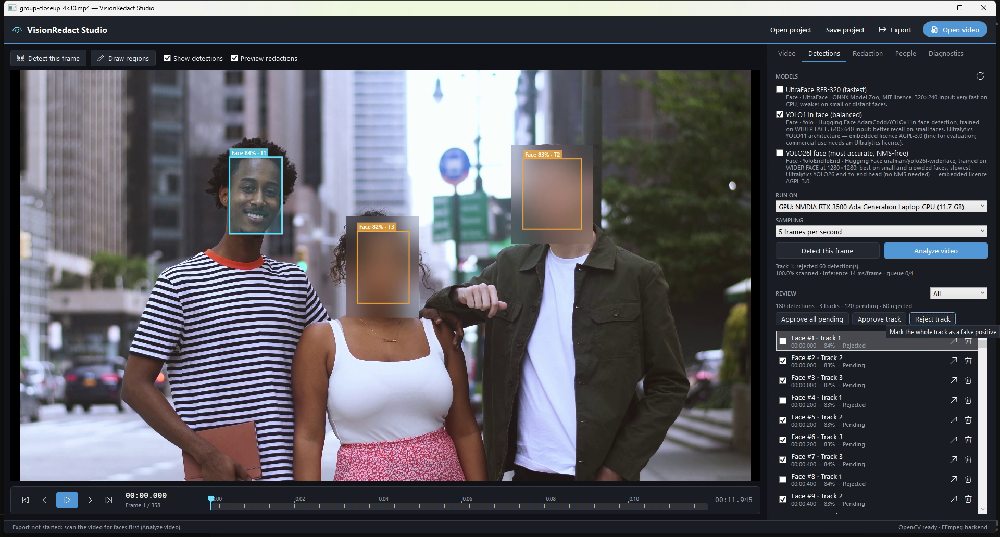
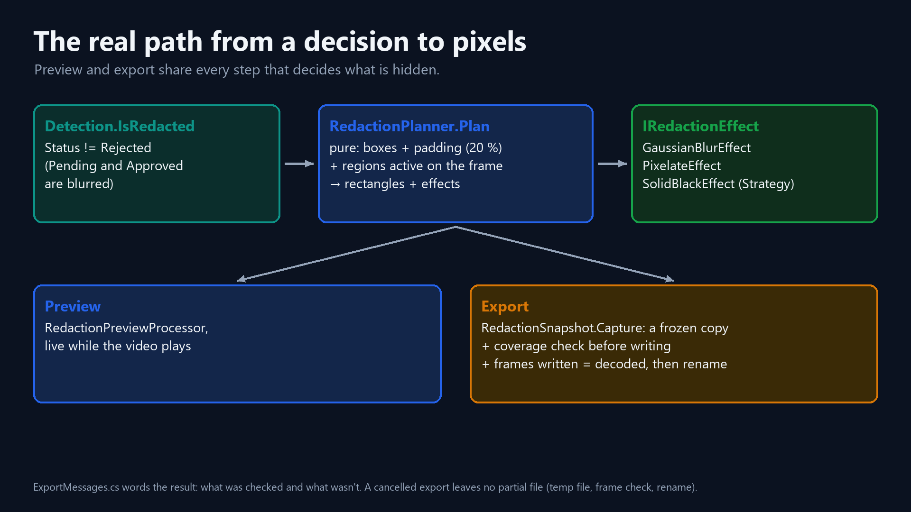
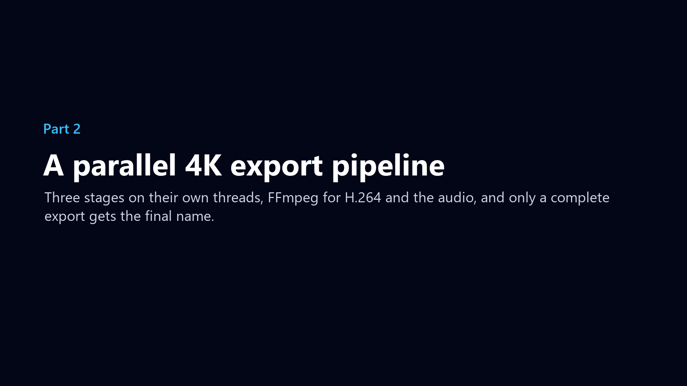
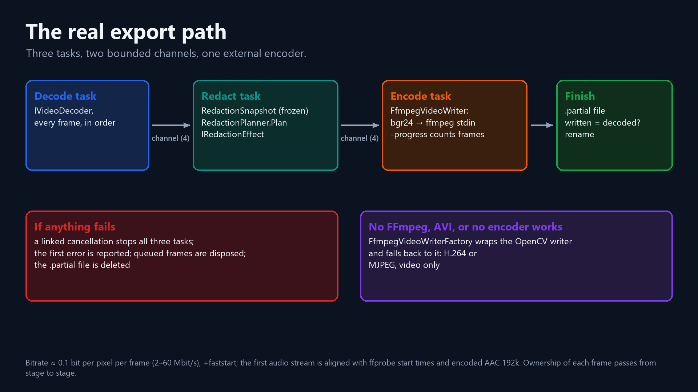
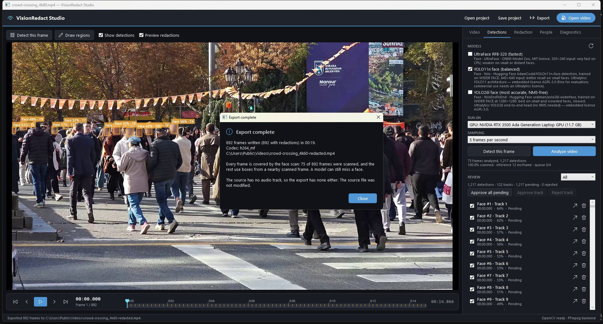
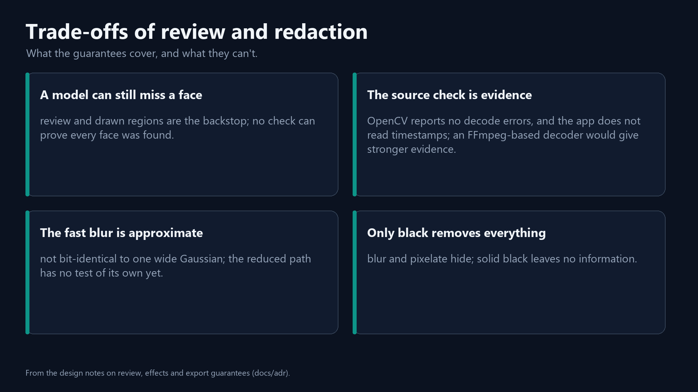
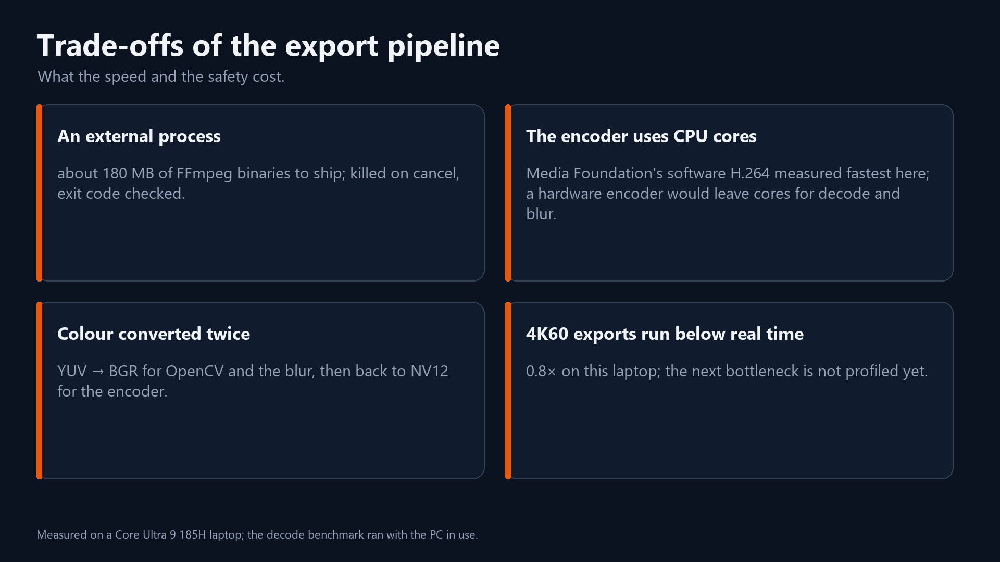

# Redaction you can trust: fail-safe review and a parallel 4K export pipeline in C# and FFmpeg

*A detected face stays blurred until someone rejects it. Episode 4 of the VisionRedact series. C# · .NET 10 · OpenCV
(Emgu CV) · FFmpeg.*

One video can give a reviewer tens of thousands of AI face boxes, and nobody checks them one by one. So the first
decision in the review design was what happens to the boxes nobody looks at. They stay blurred. In the code, that rule
is one line, and it gives this episode its tagline.

It took me longer to see where the rule stops. It protects the faces the AI found, and only those. Until I added a
coverage check, a video that nobody had scanned was exported with no face blurred automatically, and the app said
nothing. No bug report found this. I found it myself, by asking what the rule doesn't cover and walking the export
through a video with no boxes at all.

So the trust in the title doesn't come from the model alone. The AI proposes, a person reviews and draws what the AI
missed, and the export works from a frozen snapshot of that reviewed state.



> **How I measured.** I used the same laptop and Release builds as in episode 1 (Core Ultra 9 185H, RTX 3500 Ada). The
> 1080p export speeds come from my export benchmark on the first 1,800 frames of a 23-minute 1080p59.94 camcorder
> file, with one blurred region on every frame. Ranges are the spread across runs, and I didn't record the PC's state.
> The blur timing is 100 runs on one 576×324 region. The export speeds that go with it come from an earlier run on a
> 900-frame synthetic 1080p clip. The 4K per-frame figures come from a later benchmark run over my demo clips, with the
> PC in use. The 4K export times come from the app.

## Part 1: review and redaction

### Pending means blurred

The AI's boxes are proposals. Each detection carries a review status, and a new one starts as `Pending`:

```csharp
// src/VisionRedact.Domain/Detections/Detection.cs
public enum ReviewStatus
{
    Pending = 0,
    Approved,
    Rejected,
}

// in record Detection, whose Status defaults to Pending:
    // Fail-safe rule in one line: everything is blurred unless a human explicitly rejected it.
    public bool IsRedacted => Status != ReviewStatus.Rejected;
```

A pending detection, which nobody has looked at, is blurred. An approved one is still blurred, because approving
only records that someone checked. Only a rejected detection is shown as it is: someone decided it is not a face, or
that it may stay visible.

I chose opt-out because the two possible mistakes differ in size. A missed face in a released video is a privacy
incident. An extra blurred patch is cosmetic. And reviews are often left unfinished. With opt-in, an unfinished review
exports unblurred faces. With opt-out, every face the AI found stays blurred, and the worst case is over-redaction.

Review works on whole tracks. "Reject track" and "Approve all pending" are each a single
`IDetectionRepository.UpdateStatusWhere` call, so rejecting one false-positive track removes it on every frame.
Rejected detections stay stored, so a reject can be undone.

For faces the AI missed, there are drawn regions (a box over a frame range, which can follow a tracked path) and the
larger model from episode 3, YOLO26l.

Animation: [fail-safe review](visuals/review_anim_2_failsafe.mp4) (an illustration of the real rule). Stills:
[reject a track](visuals/review_app_reject.png), [approve all](visuals/review_app_approve.png).

### One planner for the preview and the export

"What you reviewed is what you export" is easy to break when the preview and the export each have their own code. So
one static function decides a frame's rectangles, and both the live preview (`RedactionPreviewProcessor`) and the
export (`RedactionSnapshot.PlanFor`) call it:

```csharp
// RedactionPlanner.Plan (Application layer): pure, no state, safe on any thread
foreach (var detection in detections)
{
    if (!detection.IsRedacted)
    {
        continue;
    }

    var roi = detection.Box.Inflate(settings.Padding).ToPixels(frameWidth, frameHeight);
    if (!roi.IsEmpty)
    {
        instructions.Add(new RedactionInstruction(roi, settings.DetectionEffect));
    }
}
```

Each box first grows by the padding (0.2 of the box size per side by default, because model boxes hug the face). Then
it is converted to pixels, rounded outward and clamped, so no out-of-range rectangle reaches native code. The manual
regions active on the frame come next, each with its own effect. Both callers pass the same detections, from
`GetForDisplay(frame)`. The face scan runs the model only on sampled frames (5 a second by default), so most frames
are never analyzed. For those, `GetForDisplay` holds the last analyzed frame's boxes for up to `HoldFrames` frames,
sliding each box along its track toward the next analyzed frame (episode 3).

The export never reads live state. Pressing Export takes a snapshot (`RedactionSnapshot.Capture`) of the detections,
analyzed frames, regions and settings. Capturing it takes about 6 ms for 50,000 detections. The reviewer can keep
working, and the file reflects the review at the moment Export was pressed.

A test exports a fake 50-frame video with a pending face on frame 10, a rejected one on frame 20 and a black region on
frames 30–32. Exactly frames 10 and 30–32 must reach the redaction processor. The test checks the plan. Pixels are
left to the effect tests.

Animation: [one rule for what gets hidden](visuals/review_anim_1_simple.mp4).



### Effects as a Strategy

Blur keeps the context, pixelate clearly shows that something was redacted, and solid black removes everything. Each
effect is a class behind one interface, `IRedactionEffect`. `GaussianBlurEffect`, `PixelateEffect` and
`SolidBlackEffect` live in Infrastructure.Video, so the Application layer decides *where* and *which* without touching
native code. `RedactionProcessor` looks up each instruction's effect by kind, clamps the rectangle again before the
native pixel write, and throws if an effect is missing. A setup bug should fail loudly, because a missing effect that
quietly skipped a face would be the worst bug this app could have.

Effect sizes scale with the region, so a 30 px face and a 400 px face get the same blur relative to their size. The
blur kernel is 25–75 % of the region's short side, depending on strength, with two passes at strength 0.5 or more.
Pixelate blocks are 8–25 % of the short side, at least 2 px. The defaults are blur, padding 0.2 and strength 0.8.

Blur and pixelate keep a little of the original signal, and recognition models can sometimes identify a blurred face
(McPherson, Shokri and Shmatikov, [Defeating Image Obfuscation with Deep Learning](https://arxiv.org/abs/1609.00408),
2016). Their result is closed-set identification: a classifier trained on obfuscated images of a known set of people
picks out who is in the picture, without reconstructing the face. Solid black is the only effect that removes
everything. For an evidence copy, I would use the black box.

### The blur that ate 80 % of the export

The first blur ran one wide Gaussian directly on the region. Its cost grows with the number of pixels times the kernel
size, and the kernel grows with the region. One 576×324 region on a 1080p frame at strength 0.8 took **61.9 ms**. A
1080p export with one blurred region ran at **13 frames/s**, about 77 ms per frame: about 4 ms to decode, 8 ms to
encode and 62 ms to blur. The blur was 62 of those 77 ms, about 80 %.

So the blur now shrinks the region first. A region whose short side is over 64 px is shrunk so that side is 48 px (area
averaging), blurred with a kernel sized for the small copy, and stretched back (bilinear):

```csharp
// GaussianBlurEffect.Apply, regions with a short side over 64 px
var scale = (double)ReducedSize / shortSide;
var small = new Size(Math.Max(1, (int)Math.Round(roi.Width * scale)), Math.Max(1, (int)Math.Round(roi.Height * scale)));
using var reduced = new Mat();
CvInvoke.Resize(view, reduced, small, 0, 0, Inter.Area);
BlurInPlace(reduced, Odd(Math.Max(3, (int)(ReducedSize * relativeKernel))), passes);
CvInvoke.Resize(reduced, view, new Size(roi.Width, roi.Height), 0, 0, Inter.Linear);
```

The 576×324 region becomes 85×48 and is blurred twice with a 31×31 kernel. It now takes **1.5 ms per region (41×)**,
and an export of a 900-frame synthetic 1080p clip, one region per frame, went from **13 to 75 frames/s** (5.7×).
Smaller regions keep the direct path.

The speed-up cost me two things. First, the new low-pass (area average, blur, bilinear) differs slightly from one wide
Gaussian, so the output is **not bit-identical** to the old one. It looks the same at this strength, and detail finer
than about 1/48 of the region is gone either way. Second, the tests that check that fine detail is destroyed, and that
nothing outside the region changes, use a small region. A small region takes the direct path.
**The reduced-resolution path has no test of its own yet.**

Animation: [shrink, blur, enlarge](visuals/review_anim_3_blur.mp4), an illustration of the method on a real frame, with
the measured timings.

### Frames the scan never reached

A frame the scan never reached has no boxes. That happens when there was no scan, when the scan was canceled, or when
the frame lies more than `HoldFrames` frames after the last analyzed frame. The faces on such a frame were exported
unblurred unless a drawn region covered them, and nothing told the user. I had made review fail safe, but I never
asked the same question about the scan.

`RedactionCoverage` now counts the frames that have AI detections to rely on. It uses the same hold rule as
`GetForDisplay`: a frame is covered if it was analyzed, or if an analyzed frame lies at most `HoldFrames` before it.
Coverage is computed from the export snapshot. When coverage is incomplete, Export asks the user first. For a video
with no scan, the dialog reads:

> **Not every frame is covered by the face scan**
>
> This video has not been scanned for faces yet.
>
> Without a scan there are no face boxes, so no face will be blurred in the export. Only manual regions apply.
>
> To cover the whole video, run "Analyze video" first.
>
> Export anyway?

For a partial scan, the middle of the dialog says "Only {x} % of this video is covered by the face scan.", then
"Frames the scan doesn't cover have no face boxes, so faces on them will NOT be blurred. Manual regions still apply.",
then "Not covered: {ranges}." (up to three time ranges, then "and N more").

No is the default button. Declining writes nothing, and the status line says "Export not started: scan the video for
faces first (Analyze video)." The percentage is rounded down, so 99.96 % is displayed as 99.9 %, and a nearly complete
scan never shows a reassuring 100 %. The user can still answer Yes. Blocking export below 100 % is not implemented. It
is a possible next step for regulated workflows.

My first completion dialog said every frame was "covered", which read like a privacy promise. I changed it to
"scanned". An independent review then rightly caught that "scanned" wasn't true either. With the default 5 scans a
second, about 1 frame in 12 of a 60 fps video is analyzed, and the rest use a nearby scanned frame's boxes. The dialog
now says which is the case. "Covered" is back, but only as "covered by the face scan", and the full-coverage message
gives the number of frames actually scanned. The dialog shows "Every frame was scanned for faces (a model can still
miss a face)." only when the scan analyzed every frame. Otherwise it says "Every frame is covered by the face scan:
{n} of {total} frames were scanned, and the rest use boxes from a nearby scanned frame. A model can still miss a face."
An incomplete scan gets "Warning: only {x} % of the video is covered by the face scan; faces on the other frames were
not blurred automatically."

Stills: [the warning](visuals/review_app_warning.png), [declined](visuals/review_app_declined.png). Animation:
[coverage](visuals/review_anim_4_coverage.mp4) (an illustration: its 80 % and time ranges are made up, and the dialog
wording is the app's, shortened).

### What each check proves

The coverage check and the two export checks in Part 2 each prove something narrow:

| Check | It shows | It does not show |
|---|---|---|
| Coverage complete | every frame was analyzed, or is held from a sample at most `HoldFrames` earlier | that every face was found: a model can miss a face on a frame it analyzed |
| Frames written = frames decoded | the encoder wrote every frame it was given | that the decoder read the whole source |
| Frames decoded ≈ the file's frame count | no large part of the source is missing | that nothing is missing: some formats only estimate the count, and a loss inside the tolerance passes |

A few things hold by design. Unreviewed detections are blurred, preview and export use the same planner, the export
reflects the review when Export was pressed, nothing half-written sits under the target name, and the source is never
overwritten.

For my 4K30 close-up clip (358 frames), the [completion dialog](visuals/review_app_complete.png) says "358 frames
written (358 with redactions) in 00:08.", "Codec: h264_mf", "Every frame is covered by the face scan: 60 of 358 frames
were scanned, and the rest use boxes from a nearby scanned frame. A model can still miss a face." and "The source has
no audio track, so the export has none either. The source file was not modified."

That audio line was wrong at first too. It told the user to install FFmpeg for every silent export, even when FFmpeg
was installed and the source simply had no audio. It now gives one of four reasons: audio included, none in the
source, the source's audio unreadable, or a writer that can't carry audio.

Animation: [what the checks guarantee](visuals/review_anim_5_guarantees.mp4).

## Part 2: the export pipeline



The first time I ran my new FFmpeg writer, the export measured **49 frames/s**. That was below the 72–80 frames/s of
the OpenCV writer it was meant to replace. The cause was mine. I had mapped the source's audio into the output but
never told FFmpeg where to stop. So a 1,800-frame test export still waited for FFmpeg to read the source's whole
23-minute audio track. One filter and one flag later, the same test ran at 167 frames/s. But first, the export that
took longer than the video.

### Export never drops a frame

Playback may skip a late frame to stay in real time (episode 1). The export never does. `VideoExportService` opens its
own decoder, reads from frame 0 in order (it never seeks, skips or drops), redacts each frame with the snapshot's plan
and encodes it. The first version did all of that in one loop.

Animation: [the export in four steps](visuals/export_anim_1_simple.mp4).

### One loop, then three stages: 52 → 74 frames/s

Exporting the 23-minute camcorder file (82,373 frames) took about half an hour. In the app, under the debugger, it
ran at about 40 frames/s. I had picked that file on purpose, because real redaction jobs start from long recordings,
not short clips. My benchmark measured the loop at **52 frames/s** on the first 1,800 frames of that file, encoding
H.264 through OpenCV's writer with OpenH264.

I looked for hardware help inside OpenCV first. Every time I asked its writer for hardware acceleration, the writer
failed to open. Hardware decoding was slower (120 against 386 frames/s), probably because each frame had to come back
from the GPU.

So I timed each stage on its own, on 300 real frames: decode took about 2.6–4.7 ms, blur about 1.5 ms per region, and
encode 10–13 ms. A loop pays the sum of all three on every frame. But these are independent, blocking native calls, so
they can overlap. The export now runs three `Task.Run` stages (decode, redact, encode), joined by two bounded channels:

```csharp
// VideoExportService.RunPipelineAsync; StageCapacity = 4
var options = new BoundedChannelOptions(StageCapacity) { FullMode = BoundedChannelFullMode.Wait, SingleReader = true, SingleWriter = true };
var decoded = Channel.CreateBounded<OwnedVideoFrame>(options);
var planned = Channel.CreateBounded<OwnedVideoFrame>(options);
```

A stage that gets ahead waits. At most about 11 frames are in flight (4 + 4 + one per stage), about 66 MB at 1080p,
whatever the video's length. One reader and one writer per channel keep the frames in order. A frame belongs to one
stage until the next channel accepts it. If the channel refuses it, the stage disposes it. The encode stage disposes
every frame it writes. When a stage fails, one linked `CancellationTokenSource` stops all three stages. The exception
that caused the stop is the one reported, and leftover frames are drained and disposed. A test with a failing
redaction stage checks that the root cause is reported and that the frames are disposed.

That took the export from **52 to 74 frames/s (1.4×)**, just under the encoder's own encode-only rate of 75–79
frames/s. With OpenCV's MPEG-4 codec (`mp4v`) instead of H.264, the same change gave 60 → 86 frames/s. The export
was now encoder-bound.

Animation: [three stages in parallel](visuals/export_anim_2_stages.mp4).



### A faster H.264 encoder, and the audio: 147–167 frames/s

This is not FFmpeg beating OpenCV. OpenCV's writer, with the FFmpeg backend the app uses, is itself built on FFmpeg's
libraries. What changed is the H.264 encoder. OpenCV's writer offers H.264 only through OpenH264, which managed about
75 frames/s at 1080p here, and it writes no audio and has no bitrate control. A standalone FFmpeg 9.0 on the same
laptop could use Windows' Media Foundation H.264 encoder (`h264_mf`) instead. That encoder reached 421 frames/s on the
real file, and the conversion from the app's BGR frames to NV12 (the YUV 4:2:0 layout the encoder takes) ran at 631.
So I built a writer that hands the frames to `ffmpeg.exe`.

`FfmpegVideoWriter` runs `ffmpeg.exe` as a child process and streams raw frames to its stdin, straight from a span over
the native frame memory:

```csharp
var args = new List<string>
{
    // … logging options …
    "-f", "rawvideo", "-pix_fmt", "bgr24", "-s", $"{source.Width}x{source.Height}",
    "-framerate", FrameRate(source.FramesPerSecond), "-i", "pipe:0",
};

if (audio is not null)
{
    // Input 1: the original source file. FFmpeg will demux it and take only its audio stream.
    args.AddRange(["-i", source.SourcePath]);
}
```

I first described `h264_mf` as a hardware encoder. Then I checked. Called the way the app calls it, Media Foundation
loads Microsoft's **software** "H264 Encoder MFT". FFmpeg's verbose log names it. Windows' GPU engine counters showed
no GPU engine busy. On a test pattern, the encoder used about 4 CPU cores at 1080p60 and 6–7 at 4K60. The speed-up
over OpenH264 comes from a much faster, multi-threaded software encoder. I considered forcing Media Foundation's
hardware path (`-hw_encoding 1`, which loads Intel's Quick Sync encoder). I didn't, because standalone on this CPU it
was slower: 339 against 421 frames/s.

The bitrate is about 0.1 bit per pixel per frame (12.4 Mbit/s at 1080p60), clamped to 2–60 Mbit/s. `+faststart` puts
the MP4 index at the front of the file, and the frame rate is passed exactly (`60000/1001` for 59.94).

Same benchmark, same 1,800 frames, pipelined:

| Writer | Frames/s | Size | Audio |
|---|---|---|---|
| OpenCV's writer (OpenH264) | 72–80 | 148 MB | no |
| FFmpeg (`h264_mf` + AAC) | **147–167** | **45 MB** | yes |

The FFmpeg writer is about twice as fast and carries audio. At the bitrate I chose (about 12.4 Mbit/s), its file is
also under a third of the size. I didn't measure picture quality. For the whole 23-minute file, these rates work out to
about 26 minutes with one loop, 19 with three stages and 9 with FFmpeg. Those times are computed, not timed.

Compared with calling FFmpeg's libraries through P/Invoke, a child process buys three things. A native crash or leak
can't take the WPF app down, there is no binding layer, and the LGPL binaries are used unmodified. The costs are one
pipe copy per frame (6 MB at 1080p, measured not to be the bottleneck), about 180 MB of binaries, and a process to
manage (killed on cancel, exit code checked).

The fallback is a wrapper. `FfmpegVideoWriterFactory` implements the same `IVideoWriterFactory` and does the work
itself. It calls the OpenCV factory it wraps only when FFmpeg can't do the job. That happens for AVI, when
`ffmpeg.exe` is missing or fails to start, and when no H.264 encoder passes a 10-frame test encode. Then OpenCV's
writer takes over: H.264 (`avc1`, else `mp4v`) for MP4, Motion-JPEG for AVI, video only. The pipeline only knows
`IVideoWriter`. That interface gained an explicit `Complete()`, because finishing a file can fail.

Animation: [the FFmpeg writer](visuals/export_anim_3_writer.mp4).

### The audio bug: 49 → 167 frames/s

Back to my 49 frames/s. The fix pads the audio and stops at the shortest stream:

```csharp
args.AddRange(["-map", $"1:{audio.StreamIndex}", "-af", audio.Filter + ",apad", "-c:a", "aac", "-b:a", "192k", "-shortest"]);
```

The same test went to **167 frames/s**. `apad` keeps the audio from ending before the video, and `-shortest` ends the
file with the video stream. Together they also fix full exports whose audio runs slightly long or short. `-shortest`
cuts on buffered audio, so the end lands close to the last frame. The tests require the durations to match within
0.1 s.

The first audio stream is aligned to the first video frame using the start times from ffprobe: `adelay` if the audio
starts later, `atrim` if it starts earlier. It is then re-encoded to AAC at 192 kbit/s, because MP4 players don't
reliably play the AC-3 that camcorders record. Another test checks that a 0.5 s offset survives.

Animation: [the audio bug](visuals/export_anim_5_audio.mp4).

### Only a complete file gets the name

The output is an evidence copy, so the target name must only ever hold a complete file:

```csharp
// VideoExportService.ExportAsyncCore (excerpt)
writer.Complete(); // flush + close the container; an encoder failure surfaces here, not in Dispose
var read = Interlocked.Read(ref counters.Decoded);
if (writer.FramesWritten != read)
{
    throw new ExportException(ExportErrorKind.IncompleteOutput, $"Encoded {writer.FramesWritten} of {read} frames.");
}
// ... (more than zero frames; writer and decoder disposed)
File.Move(tempPath, request.OutputPath, overwrite: true);
```

1. Frames go to `<name>.partial-<guid><ext>` in the target folder. The target stays untouched until step 4.
2. `Complete()` closes ffmpeg's stdin, waits for ffmpeg to exit and checks its exit code.
3. Frames written must equal frames decoded and be more than zero. Otherwise the export fails as `IncompleteOutput`.
   With FFmpeg, the written count is ffmpeg's own `-progress` frame number, read after ffmpeg has exited. That proves
   the encoder wrote everything it received. Whether the decoder read the whole source is the check described in the
   next section.
4. Only then does the file get its real name, replacing an older export. The temp file sits in the same folder, so the
   move is a rename on the same volume.
5. A failure or a cancel deletes the temp file: "Export cancelled. No partial file was left behind." A crash before
   step 4 can leave a stray `.partial` file. It can never leave a truncated file under the target name.

Writing straight to the target name would be simpler. But then a crash, a cancel or an encoder failure would leave a
truncated file under the name the user asked for. The rename can still fail if the target is locked, and that
surfaces as an access-denied error. An output path equal to the source is rejected before anything is decoded, and
the source is only opened for reading.

Animation: [only a complete file gets the name](visuals/export_anim_4_atomic.mp4).

### The source that ended early

OpenCV silently skips frames it can't decode. When decoding fails for good, it returns false, just as it does at the
end of the file. So a truncated source used to export as a shorter video that still passed the count check. Now the
decoded count is compared with the container's frame count:

```csharp
internal static bool SourceEndedEarly(long decoded, long expected) =>
    expected > 0 && expected - decoded > Math.Max(3, expected / 200);
```

The tolerance (3 frames or about 0.5 %, whichever is larger) exists because some containers, such as MPEG-TS, only
estimate their frame count. The tests flag 60 of 100 frames as an early end and let 98 of 100 pass. The file stays
valid. The dialog ("Export complete, but the source ended early") says: "Warning: the source stopped after N of about
M frames. The end of the file may be damaged or missing; the export contains only the frames that could be read."

This check is **evidence, not proof**. OpenCV reports no decode errors, and the app doesn't read frame timestamps
(frame time is index ÷ fps), so a loss inside the tolerance passes. OpenCV already exposes each frame's timestamp
(`CAP_PROP_PTS`), so checking timestamps against the stream's duration would need no new decoder. Reporting decode
errors as errors would need one, and that is what an FFmpeg-based decoder would add.

### 4K, and color converted twice



Recorded in the app, with every frame redacted (the dialog shows "Codec: h264_mf"):

| Clip | Frames | Export time |
|---|---|---|
| close-up, 4K30 | 358 | 8 s |
| crowd, 1080p60 | 892 | 5 s |
| crowd, 4K60 | 892 | 19 s, about 0.8× real time |

In my later benchmark run over the demo clips, a 4K export frame cost 3.7 times as much as a 1080p one at steady state
(5.4 → 19.9 ms on a 30 fps street clip, 5.6 → 20.8 ms on the crowd clip). A frame time of 20.8 ms is about 48 frames/s,
so the 4K60 export runs at 0.8× real time on this laptop.

**Half of a 4K decode is color conversion**: 6.70 of 13.01 ms per frame on the 4K60 crowd clip, and 6.72 of 13.30 ms
on a 4K30 street clip. Allocating a new buffer for each frame accounts for another 2.7–3.1 ms of those 13 ms. The
decoder's YUV picture is converted to BGR, the format OpenCV and the blur work in. Then FFmpeg converts BGR back to
NV12 (a YUV format) for the encoder. Removing that round trip, by keeping frames in YUV or on the GPU, would likely
help. I haven't measured it, and the blur needs BGR today.

Animation: [color converted twice](visuals/export_anim_6_colour.mp4).

## Trade-offs





- An unreviewed export blurs every false positive too. I chose that direction of error.
- Track-level review depends on the tracker. A track that wrongly merged two objects is rejected as a whole.
- The fast blur is approximate, and its path has no test of its own.
- Speed costs memory and threads: about 11 frames in flight, three threads, a copy of every detection, and disk space
  for a second file until the rename.
- FFmpeg means about 180 MB of binaries to ship and a child process to manage. It also uses CPU cores that a hardware
  encoder would leave free for decoding and blurring.
- Color is converted twice, and 4K60 exports run at about 0.8× real time here.

## Known limits

- A face the model misses on a frame it analyzed is caught only if a reviewer draws a region over it, and the coverage
  warning can be answered Yes. Without a ground-truth evaluation of the detector's misses, I don't claim that no face
  leaks.
- With the fast defaults (YOLO11n, 5 scans a second), about 1 in 6 faces seen between scans on my one-minute test file
  had no box, because YOLO11n had missed that face on the scanned frame (episode 3 has the numbers). The larger model,
  denser sampling and review are there to close that gap.
- I haven't profiled where the 4K export's next bottleneck is.
- Preview and export match for the same detections. But the preview may skip late frames, and a scan repeated with CPU
  inference gives slightly different boxes than one on the GPU, so two machines can disagree.
- There is no audit trail of who approved what, and when.
- Output has a constant frame rate (frame time is index ÷ fps), so variable-frame-rate sources are re-timed. Their
  audio can then drift out of sync with the picture, because the audio is only aligned at the start and padded or
  trimmed at the end, not re-timed. Subtitles and data streams are not carried over.
- `ffmpeg.exe` isn't tied to the app with a Windows job object. On cancel the app kills it, but if the app itself
  crashed, ffmpeg would see its input end and stop, and a partial output file could be left behind.
- Where the project goes next is the whole pipeline on the GPU.

Episode 5 is the engineering behind all of this: the architecture, the threads, and the measurements that lied.

## Source

- `src/VisionRedact.Domain/Detections/Detection.cs`, `src/VisionRedact.Domain/Redaction/RedactionRegion.cs`
- `src/VisionRedact.Application/Redaction/RedactionPlanner.cs`, `RedactionContracts.cs`, `RedactionPreviewProcessor.cs`
- `src/VisionRedact.Application/Detections/RedactionCoverage.cs`, `InMemoryDetectionRepository.cs` (`GetCoverage`)
- `src/VisionRedact.Application/Export/VideoExportService.cs`, `RedactionSnapshot.cs`
- `src/VisionRedact.Infrastructure.Video/RedactionEffects.cs`, `FfmpegVideoWriter.cs`, `EmguVideoWriter.cs`
- `src/VisionRedact.Presentation.Wpf/Shell/ExportMessages.cs`
- `tests/VisionRedact.Application.Tests/Export/VideoExportServiceTests.cs`
- `docs/Performance.md` (the blur, pipelined export and FFmpeg writer sections), `docs/ExportPipeline.md`
- `docs/adr/0014-human-review-fail-safe.md`, `0015-redaction-effects-strategy.md`,
  `0019-export-snapshot-atomic-output.md`, `0020-ffmpeg-exporter.md`
- [measurements.md](../measurements/measurements.md), [b10-output.txt](../measurements/b10-output.txt) (the 4K figures)

Footage by William Fortunato and Talha Uguz on Pexels.
