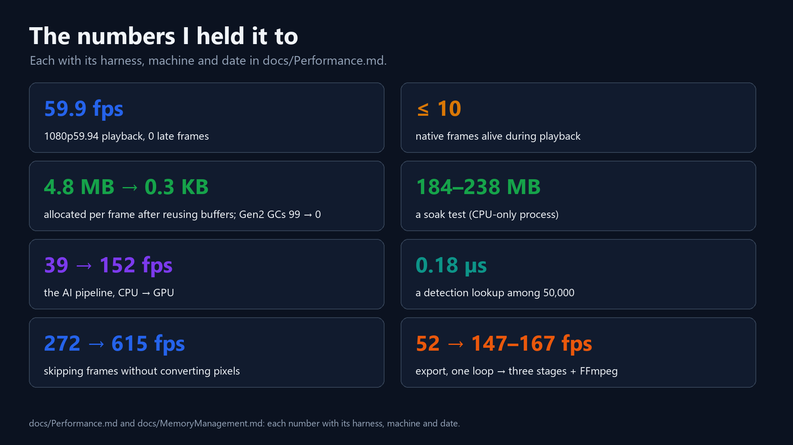
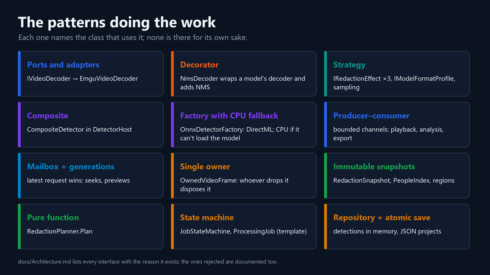
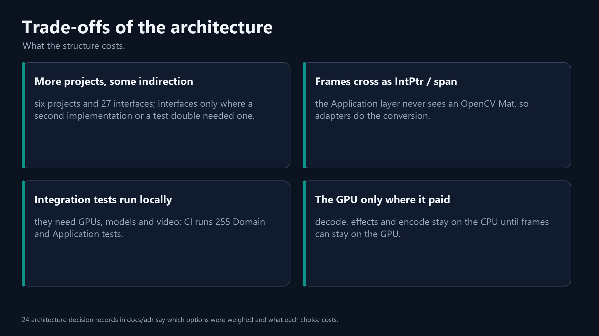

# The engineering behind VisionRedact: architecture, threads, and measurements that lied

*VisionRedact Studio, episode 5 of 5. The rule a test enforces, and two measurements that lied.
C# · .NET 10 · WPF · xUnit · GitHub Actions.*

The first decision I wrote down for VisionRedact Studio said its layer boundaries were "enforced by the compiler".
That was wrong. Project references stop a cycle, but they don't stop a package. Adding Emgu CV (the OpenCV wrapper)
to the Application project would have compiled, and nothing in the build would have noticed. I caught the error while
fact-checking this series: I asked what would actually fail if someone added the package, and the answer was nothing.

So this last episode starts with the test that now checks the rule: the inner projects, Domain and Application, depend
on no library and no outer project (Application's one exception is the logging abstractions).

> **How I measured.** I used the same laptop and Release builds as in episode 1 (Core Ultra 9 185H, RTX 3500 Ada).
> The numbers come from my benchmark harness, small harnesses built on the app's own classes, and the app's
> Diagnostics panel. A range such as 147–167 is the spread over repeated runs or passes. Some runs were on an idle,
> freshly restarted PC and some on a PC in use. For a few, I didn't record which. Where that matters, or where a cause
> is likely but unproven, the section says so once.

## Six projects, dependencies pointing inward

- **Presentation.Wpf** is the composition root (WPF, Prism with DryIoc, Serilog). Inside it, only `App.xaml.cs`
  refers to the concrete adapters, when it registers them in the container.
- **Infrastructure.Video** wraps Emgu CV 4.13 (OpenCV) and holds the FFmpeg writer.
- **Infrastructure.AI** runs ONNX Runtime (the DirectML build, 1.24.4), YuNet and ArcFace. YuNet and ArcFace group faces into
  people: YuNet finds five landmarks to align each face, and ArcFace turns it into 512 numbers.
- **Infrastructure.Persistence** saves projects as JSON, atomically.
- **Application** holds ports, pipelines and use cases, with one package (Microsoft.Extensions.Logging.Abstractions).
- **Domain** holds detections, tracks, review states and redaction rules, with no references and no packages.

The policy, meaning the use cases and pipelines in Application, owns the interfaces. It declares 27 public interfaces
and two abstract classes: `OwnedVideoFrame` (a frame whose pixels live in native memory) and `ProcessingJob` (the
lifecycle of analysis, export and region tracking). Most are ports to the outside world (a decoder, a detector, a video
writer). Some are services that Application implements itself, like the export service, so that a caller can be tested
with a fake.

My first decision record weighed three shapes. A single WPF project would have left the playback worker untestable
without WPF. At this size, full Clean Architecture (an interface per class, a mediator and mapping layers) would be
ceremony that buys nothing and slows every change. I chose plain layers, with an interface only where a second
implementation or a test double needs one. `docs/Architecture.md` gives each interface its reason and lists the ones I
rejected, such as an `IPlaybackClock` (.NET's `TimeProvider` already has a fake).

That choice paid off in two ways I can count: 258 tests need no GPU (CI runs 255 of them; three timing tests run
locally), and the export writer was replaced through one adapter, one registration and one new method on the port.

There is an animation of [the dependencies pointing inward](visuals/anim_1_layers.mp4).

## The rule, checked by a test

`DependencyRulesTests`, in the Application test project, fails when the rule is broken:

```csharp
private static readonly string[] Forbidden =
[
    "Emgu", "Microsoft.ML.OnnxRuntime", "PresentationCore", "PresentationFramework", "WindowsBase", "System.Xaml",
    "Prism", "DryIoc", "Serilog", "VisionRedact.Infrastructure", "VisionRedact.Presentation",
];

[Fact]
public void Application_references_no_library_and_no_outer_layer()
{
    var references = typeof(PlaybackSession).Assembly.GetReferencedAssemblies().Select(a => a.Name!).ToArray();

    Assert.Contains("VisionRedact.Domain", references);
    Assert.DoesNotContain(references, name => Forbidden.Any(f => name.StartsWith(f, StringComparison.Ordinal)));
}
```

`DependencyRulesTests` checks two ways. The first reads the compiled assemblies: a sibling test asserts that Domain
references only .NET itself, and the one above that Application references Domain and nothing on the forbidden list.
A compiled assembly lists only the references its code uses, so a package that is added but not yet used would slip
through. The second check isn't shown in the sample above. It compares the `ProjectReference` and `PackageReference`
entries in both `.csproj` files with an allowed list. Any change to those entries fails the test. That is on purpose:
a deliberate change then edits the list in the same commit, in plain sight.

The test covers Domain and Application only. The other rules hold today, as the project files and a code search
show: no infrastructure project references another, and only `App.xaml.cs` refers to a concrete adapter. They aren't
in the test yet.

CI (`.github/workflows/ci.yml`) runs on every push and pull request. It builds the whole solution in Release on
`windows-latest` with warnings as errors, then runs the Domain and Application tests. Three of those tests assert a
wall-clock limit. A shared 2-core runner is too noisy for that (one failed there while passing on my laptop), so those
three run locally and CI runs the other 255. The architecture test is one of the Application tests, so every CI run
checks the rule.

There are 346 tests: Domain 76, Application 182, Integration 88. The 258 Domain and Application tests need no GPU,
video, model or FFmpeg. `FakeVideoDecoder` detects concurrent calls while a test hammers `PlaybackSession` with 400
parallel operations. Other tests check that every frame is disposed exactly once. The integration tests need real
runtimes, models and media, so I run them locally.

Another animation shows [the rule as a test, with its real output](visuals/anim_2_test.mp4).

## Swapping the video writer in one place

At first, export wrote video through OpenCV's writer (its FFmpeg backend). That meant OpenH264 only, no audio and no
bitrate control. Once export ran as a pipeline (decode, redaction and encode on three tasks, up from 52 frames/s for
one loop), that encoder set the pace. The new FFmpeg writer streams raw frames to `ffmpeg.exe` over stdin. Because
`VideoExportService` knows only the port `IVideoWriterFactory`, the FFmpeg writer went in as one new adapter and one
registration in `App.xaml.cs`.

```csharp
containerRegistry.RegisterSingleton<IVideoWriterFactory>(c => new FfmpegVideoWriterFactory(
    new EmguVideoWriterFactory(c.Resolve<ILogger<EmguVideoWriterFactory>>()),
    c.Resolve<ILogger<FfmpegVideoWriterFactory>>()));
```

`FfmpegVideoWriterFactory` is a fallback wrapper. It implements `IVideoWriterFactory` and does the work itself. It
calls the OpenCV factory it wraps only when FFmpeg can't do the job: when there is no `ffmpeg.exe`, when the export is
AVI, when no H.264 encoder works, or when Windows won't start the process. On this laptop it encodes with Media
Foundation's software H.264 encoder (`h264_mf`), which runs on the CPU.

I ran the same pipelined export both ways: the first 1,800 frames of a 23-minute 1080p59.94 camera file, with a blur
on every frame. OpenCV's writer did 72–80 frames/s and wrote 148 MB with no audio. The FFmpeg writer did 147–167
frames/s and wrote 45 MB, with audio. The gain comes from the encoder, Microsoft's against OpenH264. It doesn't come
from FFmpeg against OpenCV, because OpenCV's writer is built on FFmpeg's libraries too.

The port did change once. `IVideoWriter` gained `Complete()`, because finishing a file through another process
(close stdin, wait, check the exit code) can fail. `Dispose()` alone now means abort.

The same shape repeats in `IObjectDetector` (UltraFace, YOLO11, YOLO26) and `IRedactionEffect` (blur, pixelate, black
box). Execution-provider code lives only in `OnnxDetectorFactory`, so moving from DirectML to Windows ML should also be
one adapter change. I haven't tested that.

The swap is also [an animation](visuals/anim_3_swap.mp4).

## Which thread does what

| Thread or pipeline | What runs there |
|---|---|
| UI thread (the Dispatcher) | input, copying the finished frame into the bitmap (`WritePixels`), layout, the render pass |
| WPF's render thread | composes the window on the GPU |
| Playback | decode task → Channel(1) → redaction task → Channel(3) → present task → one-slot mailbox |
| Analysis | decode task → Channel(4) → inference task (detector on the GPU via DirectML, then the tracker) |
| Timeline previews | storyboard builder (small thumbnails made ahead of time, shown instantly on hover) on its own decoder; exact hover frames on a private reader |
| Export | decode task → Channel(4) → redaction task → Channel(4) → encode task → `ffmpeg.exe` over stdin |

The UI thread never decodes or blurs. The rest are pipelines joined by bounded queues, each with its own decoder.
The pipelines do wait, by design. A producer waits when its queue is full, which keeps memory bounded. The exact-frame
reader takes one read at a time behind a `SemaphoreSlim`. Three rules keep the threading safe.

- **Blocking native work never runs on the Dispatcher.** Opening a file, decoding, loading a model and inference run
  on pipeline tasks or through `Task.Run`.
- **Each decoder has one owner.** `IVideoDecoder` isn't thread-safe, so each of its eight users opens its own:
  playback, analysis, export, the storyboard, exact preview frames, detect-this-frame, grouping faces into people,
  and region tracking. In playback, only the decode task calls the decoder. Play, Seek and Step only write to a
  mailbox.
- **Workers never touch WPF.** Frames reach the screen only through `IPreviewFrameSink`, with at most one render
  callback queued. View models get `IUiThread`, which offers `Post` but no `Invoke`, because a synchronous `Invoke`
  from a worker deadlocks if the UI thread is blocked waiting for that worker (for example on `.Wait()` or `.Result`).

Frames have one owner too. An `OwnedVideoFrame` keeps its pixels in native memory that the garbage collector can't
see. Whoever drops a frame disposes it, in `finally`. By construction, playback holds at most
`DecodeAheadFrames + 6` = 9 frames: up to 3 in the bounded buffer (Channel(3) above), plus the frame being decoded,
the one in the one-frame channel, the one being redacted, the one the present task holds, and the sink's pending
frame and the one it is rendering. I measured 4 live frames on the 1080p59.94 file. Playback and analysis together
never went above 10.

The threads are [animated here](visuals/anim_4_threads.mp4).

## CPU or GPU, step by step

| Step | Where it runs today | Measured |
|---|---|---|
| Decode + YUV → BGR | CPU (FFmpeg inside OpenCV, no hardware decode) | ~3.7 ms per 1080p frame, ~13–16 ms per 4K frame |
| Letterbox + tensor | CPU | 2.1 ms |
| Face detection (YOLO11n) | GPU via DirectML, CPU fallback | p50: RTX 3500 Ada 4.7 ms, Intel Arc 14.2 ms, CPU 23.4 ms |
| NMS, tracking | CPU | NMS < 0.1 ms |
| People (YuNet + ArcFace: grouping face tracks by person) | CPU | – |
| Blur, pixelate, black box | CPU | see below |
| Frame onto the screen | UI thread copies it into the bitmap, WPF's render thread composes on the GPU | `WritePixels` 2.5–2.8 ms avg per 4K60 frame (GPU upload not measured) |
| Encode | `ffmpeg.exe`, Media Foundation's software H.264 encoder (CPU) | NV12 conversion, AAC, muxing: CPU (likely) |

The GPU runs the one step where I measured a win. YOLO11n on the RTX 3500 Ada is 5× faster than on the CPU, and
every-frame analysis went from 39 to 152 frames/s. Then the limit moved. At 5 samples a second on the 1080p59.94 file
(the detector sees 1 frame in 12; the decoder skips the rest without converting their pixels), the analysis queue sits
at 0 of 4 (58.5 AI frames/s, 726 decoded frames/s): inference waits for frames, so the decoder sets the pace.

I tried two other steps on the GPU, and both were slower.

- **Blur through OpenCL** (Emgu CV's built-in GPU path) ran on the integrated Intel Arc. Including the box copies to
  the GPU and back, it took 13.64 ms per frame on the 4K30 street clip, against 8.25 ms on the CPU. On the 4K60 crowd
  clip, where kernel builds inflate the GPU's mean, the p95 was 21.95 against 13.18 ms. For small regions, the copies
  and kernel launches cost more than the blur. The GPU's pixels also differed by up to 134 of 255 at box edges,
  because the CPU blur of a sub-image reads the pixels around the box and the isolated GPU copy can't. Preview would
  no longer have matched export.
- **Hardware decode through OpenCV** ran at 120 frames/s against 386 on the CPU. I put that down to copies from the
  GPU to the CPU. It was a one-off test, and I didn't record the machine's state.

A step moved to the GPU on its own pays for a copy there and a copy back. The animation goes
[step by step](visuals/anim_5_cpu_gpu.mp4).

## The numbers it's held to



| Number | What |
|---|---|
| 59.9 fps decoded, 0 late frames | 1080p59.94 playback |
| ≤ 10 | live native frames measured, playback and analysis together (playback alone: at most 9 by construction) |
| 4.8 MB → 0.3 KB | managed allocation per AI frame after reusing buffers (Gen2 collections per 300 frames: 99 → 0) |
| 184–238 MB | private bytes, 6-pass soak of playback + analysis, CPU-only process, no upward trend |
| 39 → 152 frames/s | every-frame analysis, CPU → RTX 3500 Ada |
| 0.18 µs | display lookup among 50,000 detections |
| 272 → 615 frames/s | analysis of the first 1,800 frames of the 1080p59.94 file at 1 frame in 12, skipping unsampled frames without converting pixels |
| 52 → 147–167 frames/s | export, one loop → three tasks + FFmpeg |

`docs/Performance.md` and `docs/MemoryManagement.md` give each number with its harness, machine and date. Two other
measurements of mine lied before I caught them.

## Two measurements that lied

### The busy machine

I wanted to know what the live preview blur costs per 4K30 frame, so I built a harness from the app's own classes. It
scans the clip like the app does (YOLO11n, 5 samples a second). Then it decodes every frame and times
`RedactionPreviewProcessor.Process` on it, all on one thread. At 30 fps, the budget is 33.4 ms.

| 4K30 street clip, 9.2 boxes per frame | Redaction avg | Decode avg | Sum | Frames over budget |
|---|---|---|---|---|
| Runs 1–2 | 14.4 ms | 17.3 ms | 31.6 ms | **26 %** |
| Run 3 | 7.9 ms | 14.1 ms | 22.0 ms | **0.7 %** |

Runs 1 and 2 said 4K30 preview sits at the edge of its budget, with a quarter of its frames over it. That didn't fit
the app, which played the same clip at a steady 30 FPS, so I ran the harness again. Run 3 used the same code, clip and
boxes, and it said a third of the budget was spare. Redaction differed by about 2× between the runs, and decode by
about 20 %.

The difference was the machine. The PC was in use, and a stray `find` process was holding one core. In run 3, the
cost follows the work. Per 128-frame segment, redaction averaged 10.8, 5.4, 8.3 and 4.9 ms, while the boxes per frame
went 11.6, 6.8, 10.2 and 6.2.

My mistake was trusting numbers from a machine whose state I hadn't written down. Since then, I write down the
machine's state when I measure (idle or in use, freshly restarted or not, power plan). I run variants in mirrored
order so that drift hits both sides, and I discard the cold first run after a build or a boot.

There is an animation of [the busy machine](visuals/anim_6_busy.mp4).

### An average with a cold start

I had met this trap before, with the timeline's tile lookup (a binary search for the storyboard thumbnail nearest a
frame). A microbenchmark said 71 ns, and the Diagnostics panel's mean said 7.6–11.8 µs. One JIT-cold first call of
97–109 µs dominated that mean. Episode 2 tells the story in full. The panel now shows the median of the last 64
lookups, about 2–5 µs, likely because the microbenchmark had hot caches and the UI thread meets cold ones between
lookups.

The next day I made the same mistake in another row. I had added "Layout time (UI thread)" to the panel to measure
what my zero-layout change bought: playback now draws the video, boxes, playhead and timecode with no WPF layout at
all. The row times each layout pass from the start of WPF's render tick (a Render-priority Dispatcher operation) to
`LayoutUpdated`. That is slightly high, because it includes the animation tick. The row reports time per second, over
the same 2-second window as the "Layout passes / s" row, plus a figure per pass.

The per-second figure did its job. On a freshly restarted, idle PC, the old build spent 62.10 ms of every second in
layout at 1080p60, in 60.2 passes of about 1.0 ms each. The new build spent 0.00.

The per-pass figure was wrong. I had made it an average since the panel opened. Once playback ran with no layout
passes, the only pass in that average was the panel's own first layout, from earlier. So, while no passes were
happening at all, the row still read about 17.7 ms per pass. The row beside it said zero passes a second, and a window
with no passes has no cost per pass. The per-pass figure now uses the 2-second window too.

Neither mistake slowed the app: a 5 µs lookup is 0.03 % of a 16.7 ms frame. Both made the panel wrong. For anything
with a cold start, I now report a median or a recent window.

Both are in [one animation](visuals/anim_7_averages.mp4).

## Patterns, by the problem each one solved



The first group keeps technology at the edge. **Ports and adapters** keep OpenCV out of Application: `IVideoDecoder`
says what a frame source does, and `EmguVideoDecoder` does it. **A fallback wrapper**, `FfmpegVideoWriterFactory`,
uses FFmpeg when it can and the OpenCV factory it wraps when it can't, so export always writes a file.
**A decorator**, `NmsDecoder`, adds non-maximum suppression to a model's output decoder (the code that turns raw model
outputs into boxes, not a video decoder), so only models that need NMS get it. **Strategies** (`IRedactionEffect` ×3,
`IFrameSamplingStrategy`, `IModelFormatProfile`) turn a new effect, sampling rule or model format into a new class.
**A factory with a CPU fallback**, `OnnxDetectorFactory`, creates a CPU session when DirectML fails, so a PC without a
usable GPU still scans. **A composite and a non-owning proxy** in `DetectorHost` hand a job one detector:
`CompositeDetector` for several models and `NonOwningDetector` for one. `NonOwningDetector` has an empty `Dispose`, so
it can't unload a model the host still caches.

The second group moves frames between threads. **Producer–consumer with bounded channels** (`PlaybackSession`,
`AnalysisJob`, `VideoExportService`) overlaps decode, redaction, inference and encode while capping frames in flight.
**A mailbox with generation numbers** (`PositionRequest`, the presenter's slot, `FramePreviewService`) collapses
hundreds of seeks a second into the latest one. It also drops frames decoded for an older target.
**Single ownership** of `OwnedVideoFrame` (`MatVideoFrame` in the adapter) frees native memory exactly once.
**Immutable snapshots** let readers skip the lock: `RedactionRegionStore` swaps in a new array on each change,
`RedactionSnapshot` freezes the review state when export starts, and each `PeopleIndex` edit returns a new index, so
undo just keeps the old one. **A debounce** in `FramePreviewService` waits for the pointer to rest for 100 ms,
because on a 4K clip a seek and one read take about half a second.

The last group keeps state consistent. **A pure function**, `RedactionPlanner.Plan`, decides what to redact for
preview and export alike, so the two can't disagree. **A template method and a state machine** (`ProcessingJob`,
`JobStateMachine`) give analysis, export and region tracking one lifecycle, and they reject invalid transitions.
**A repository and an atomic save** cover the data. `InMemoryDetectionRepository` indexes 50,000+ detections by
frame. `JsonProjectRepository` writes a `.tmp` file and renames it over the project file, so a crash leaves the old
file intact.

## What it costs



- **More projects, some indirection.** Application never sees an OpenCV `Mat`. Frames cross the boundary as a pointer
  or a span, and the adapters convert them.
- **One decoder per pipeline.** There are no locks around a decoder and no shared failure, but the same file is
  decoded once per running pipeline.
- **FFmpeg as a separate process.** It buys crash isolation and an unmodified LGPL build. The price is one pipe copy
  per frame (measured not to be the bottleneck) and a process lifetime to manage.
- **DirectML.** It runs on any DirectX 12 GPU with no CUDA install. But it keeps the app on an older ONNX Runtime
  (Microsoft steers new work to Windows ML), and a session raises private bytes to about 1 GB.
- **The GPU only where it paid.** Decode, effects and encode stay on the CPU until frames can stay on the GPU.

## Known limits

- **The test guards only the two inner projects.** Nothing fails yet if an outer rule breaks.
- **Integration tests run only locally.** They need runtimes, models, media and, in some cases, GPUs. So only a local
  run catches an adapter regression.
- **One laptop.** I only simulated smaller PCs, by restricting the app to some of this CPU's cores (Episode 1).
- **Some runs were on a PC in use.** The busy-machine runs still need repeating on an idle PC.
- **Not measured.** WPF's upload of the bitmap to the GPU, and how `ffmpeg.exe`'s CPU time splits between its steps.

## The v2 plan

In order, each step behind a port that already exists, with the CPU path kept as the fallback:

1. **Hardware decode** (D3D11VA / NVDEC) through an FFmpeg-based `IVideoDecoder`. With inference on the GPU, decode
   is the limit.
2. **GPU-resident frames.** The encoder receives raw pixels over a pipe, so frames that stay on the GPU need an
   in-process encoder.
3. **GPU effects, with a pixel-tolerance test** against the CPU output, so preview and export still agree.
4. **Windows ML in place of DirectML.** DirectML is in maintenance mode (Microsoft calls it sustained engineering; its
   latest package is 1.24.4). Windows ML is Microsoft's recommended path and keeps the same ONNX Runtime APIs. Its CPU
   and DirectML providers work on every supported Windows version (Microsoft now labels DirectML "legacy" there). The
   vendor execution providers are downloaded on demand through the Windows ML package
   (`Microsoft.Windows.AI.MachineLearning`) and need Windows 11 24H2 (build 26100).

None of this is done. Each step will be measured against the CPU path it replaces.

Where it's going: the whole pipeline on the GPU.

Thanks for reading the series.

---

## Source

- `tests/VisionRedact.Application.Tests/Architecture/DependencyRulesTests.cs` (commit 175d6e2),
  `.github/workflows/ci.yml`, `Directory.Build.props`
- `src/VisionRedact.Presentation.Wpf/App.xaml.cs`, `src/VisionRedact.Infrastructure.Video/FfmpegVideoWriter.cs`,
  `src/VisionRedact.Infrastructure.AI/OutputDecoders.cs`
- `src/VisionRedact.Application/Playback/PlaybackSession.cs`, `Analysis/AnalysisJob.cs`,
  `Export/VideoExportService.cs`, `Media/VideoFrameReader.cs`, `Detections/DetectorHost.cs`
- `docs/Architecture.md`, `docs/ThreadingModel.md`, `docs/MemoryManagement.md`, `docs/Performance.md`,
  `docs/Tradeoffs.md`, `docs/adr/` (0001, 0017, 0020, 0023)
- [measurements.md](../measurements/measurements.md): preview redaction cost, tile lookup, layout time, blurring on the GPU

Footage by Towfiqu barbhuiya and Talha Uguz on Pexels.
